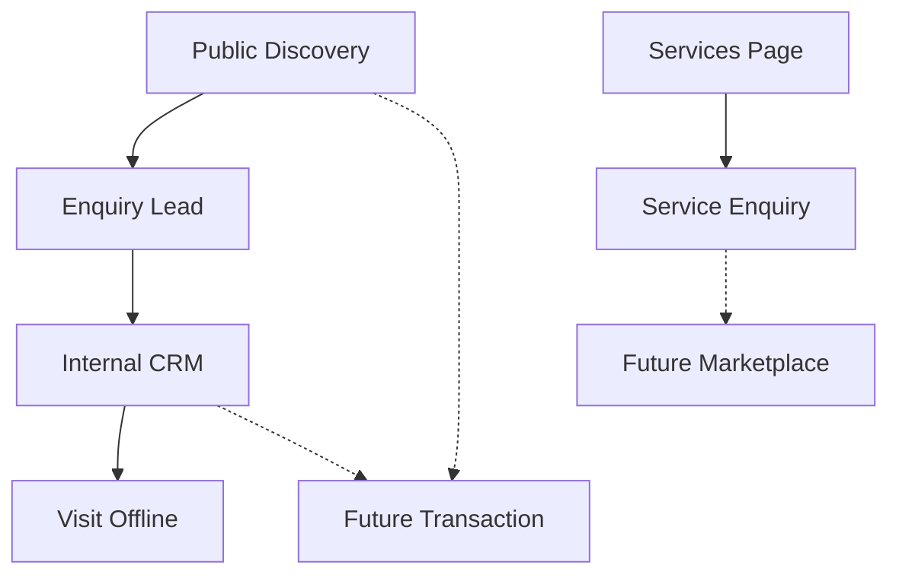
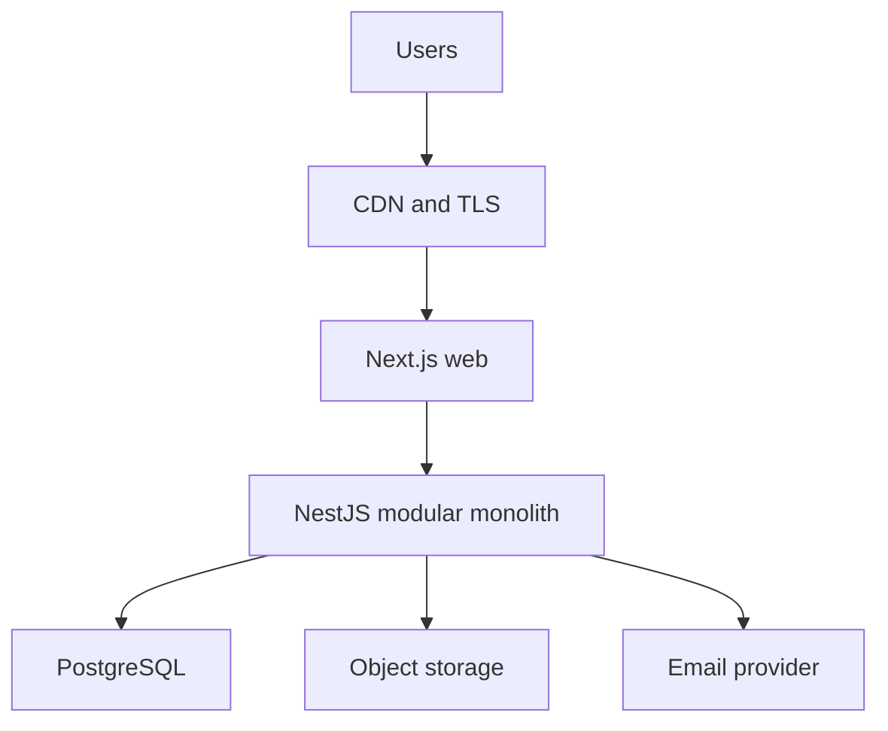
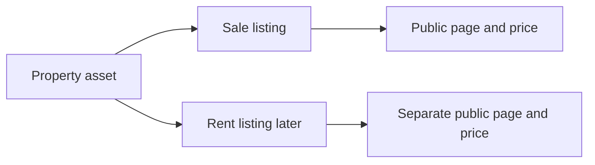

# Real Estate Platform — System Design Master Document

**Document:** Deliverable 01  
**Status:** Draft superseded on conflicts by Architecture Freeze v1 (`docs/00-architecture-freeze.md`)  
**Date:** 2026-09-26  
**Audience:** Founder / solo developer (MERN, Next.js, NestJS, PostgreSQL, TypeScript)  
**Geographic focus (assumption):** Delhi-NCR  
**Working window (constraint, not architecture driver):** 60–70 days  

This document is the foundation for later design steps. It does not contain application code, full table DDL, a complete endpoint catalog, or a frontend folder tree. Those belong to later deliverables after this document is reviewed.

Classification legend used throughout:

| Label | Meaning |
| --- | --- |
| Confirmed assumption | Working premise until evidence contradicts it |
| Proposed | Reasonable recommendation, not a locked requirement |
| MVP (P0 / Must Have) | Required to validate the business |
| Phase 2 (P1 / Should Have) | Important, after first launch |
| Phase 3 (P2 / Could Have) | Useful, not needed to launch |
| Future (P3 / Won't Have Yet) | Ecosystem idea, explicitly out of current build |
| Requires validation | Must not be treated as a requirement until confirmed |

---

## 1. Executive Summary

I recommend building a **Delhi-NCR property discovery + lead capture platform**, not a full real-estate operating system, in the first 60–70 days.

The long-term vision (discovery → visit → transaction → interiors → maintenance → property management, plus a broker/service marketplace) is valid as a product north star. It is **not** a realistic first product. If we treat that vision as MVP, the project will fail on scope, quality, and operations.

**Smallest useful MVP**

- Public property discovery for **Buy** and **Rent** in Delhi-NCR
- Admin-managed inventory (no owner/broker self-serve in MVP)
- Property enquiry / lead capture
- Saved properties and visit requests for registered customers
- Internal CRM for leads and visits
- A **services catalog + enquiry form** (not a full work-order marketplace)
- SEO-capable public pages
- Auth, RBAC, media upload, logging, backups, basic monitoring

**Explicitly deferred from MVP**

- Sell-side owner listing flow
- Transactions, token money, agreements, registration
- Payments
- Service quotations, work orders, provider marketplace
- Broker/agent ecosystem, owner portal
- Property management / tenant management
- WhatsApp automation, push notifications
- Elasticsearch / OpenSearch
- Kubernetes, Kafka, microservices, multi-region

**Architecture stance**

- Modular monolith: Next.js (web) + NestJS (API) + PostgreSQL
- Start simple, design module boundaries for later extraction
- Introduce Redis, queues, object storage, and CDN only where justified below
- PostgreSQL handles search for MVP and early growth

**60–70 day honesty**

A solo developer can ship a **credible public discovery + admin CRM MVP** in 60–70 days if scope is held. A marketplace, payments, and transaction engine cannot. The plan below protects launch quality over feature volume.

I am stopping after this document. Implementation does not start until you review and approve the open architecture decisions at the end.

---

## 2. Product Vision

**Working name (placeholder):** NCR Homes (replace later; do not couple architecture to the name).

**One-line vision:** Help people in Delhi-NCR find a home or commercial space, talk to a real human quickly, and later buy adjacent services from the same trusted platform.

**Long-term value chain (future, not MVP)**

1. Property Discovery  
2. Lead  
3. Visit  
4. Transaction  
5. Interior / Renovation  
6. Maintenance  
7. Property Management  

**Long-term marketplace loops (future)**

- Owner → Platform → Broker / Agent → Customer  
- Customer → Service Request → Provider → Quotation → Work Order → Payment → Completion  

**What is confirmed vs proposed**

| Statement | Classification |
| --- | --- |
| Initial geography is Delhi-NCR | Confirmed assumption |
| First inventory is internally sourced / admin-entered | Proposed (requires validation) |
| Primary conversion event is a lead (enquiry / call / visit request), not an online transaction | Confirmed assumption for MVP |
| Services become a second revenue line | Proposed |
| Brokers and owners will self-list later | Future idea |
| The platform will process property payments | Future idea, requires legal/business validation |
| SEO is a primary acquisition channel | Confirmed assumption |

**Product principle:** Own the discovery-to-conversation loop first. Do not build a marketplace until there is inventory, leads, and an operating team that cannot keep up with spreadsheets.

---

## 3. Scope

### 3.1 In scope for the complete product (multi-year)

- Buy, Rent, later Sell
- Residential, Commercial, Plots/Land, New projects
- Property services catalog and fulfillment
- Internal sales operations
- Later: owners, brokers, service providers, property managers

### 3.2 In scope for MVP (60–70 days)

Public:

- Home
- Search / filter listings (Buy, Rent)
- Listing detail
- Enquiry form
- Contact page
- Static/light services landing + enquiry
- SEO metadata, sitemap, locality-aware URLs (limited set)

Customer (authenticated):

- Register / login
- Profile (minimal)
- Saved listings
- Own enquiries list
- Visit request

Admin / staff:

- Auth
- Property and listing CRUD
- Media attach
- Lead inbox
- Visit scheduling (manual)
- Basic customer list
- Agent assignment (simple)

Platform:

- JWT (or session — pending approval) auth
- RBAC
- Object storage for images
- Structured logging
- Health endpoints
- Automated DB backup
- CI lint/typecheck/test/build

### 3.3 Explicitly out of MVP

- Owner self-listing / sell flow
- Broker portal and commission
- Transaction pipeline, legal docs, KYC vault
- Payments, invoices, refunds
- Quotations, work orders, provider dispatch
- Reviews/ratings as a social graph
- Map-first search (map pin browsing)
- Video transcoding
- WhatsApp Business API automation
- Multi-city outside NCR
- Multi-language
- Native mobile apps

### 3.4 Challenge to the original MVP list

The original list included Services, Analytics, Notifications, Visit management, Agent assignment, and full customer accounts as if they were equal. They are not.

I recommend cutting deeper than the original prompt:

**Keep in MVP because they validate the business**

- Discovery, listing detail, enquiry, admin inventory, lead inbox

**Keep thin, not full modules**

- Services: catalog + one enquiry form, no fulfillment
- Visits: request + admin status, no calendar product
- Notifications: email for enquiry confirmation and admin alert only
- Analytics: event log table + a few admin counts, not a warehouse
- Customer accounts: required for saved properties and visit requests; optional guest enquiry still allowed

**Drop from MVP**

- Agent assignment beyond `assigned_to` on a lead
- Customer "management" CRM beyond list + lead history
- Service request lifecycle
- Any payment-shaped object

If the 60–70 day window slips, the kill order is: services page → visit requests → saved properties → customer accounts (keep guest enquiry).

---

## 4. Assumptions

All items below are **assumptions**, not facts. Ranges are intentional.

### 4.1 Market and operations

1. Initial inventory is small: **50–300 live listings**, not 50,000.  
2. Inventory is entered by internal staff, not the public.  
3. Users are primarily Delhi-NCR buyers/renters.  
4. Conversion happens offline (call, WhatsApp, site visit), not checkout.  
5. One operator (you) plus possibly 1–2 non-technical staff at launch.  
6. No legal entity / RERA / payment compliance work is completed yet. **Requires validation.**  
7. Content quality (photos, honest prices, working phones) matters more than search sophistication at this inventory size.

### 4.2 Traffic and data

8. Launch traffic is low-to-moderate: hundreds of sessions/day, not millions.  
9. Peak is browsing + search, not write-heavy.  
10. Images dominate storage cost, not the database.  
11. PostgreSQL can serve search and filters at MVP and early growth scale.

### 4.3 Technical

12. Preferred stack (Next.js, NestJS, PostgreSQL, TypeScript) is accepted unless a concrete defect appears.  
13. Modular monolith is the right starting shape.  
14. Single region, single primary database.  
15. Secrets never live in git.  
16. You will operate this yourself; operational complexity has a real cost.

### 4.4 Assumptions I challenge

- **"We need every user role on day one."** No. Unused roles become authorization bugs.  
- **"We need Redis before launch."** Only if we have a concrete use (rate limit, queue, session). PostgreSQL + Next.js cache can cover public read pages initially.  
- **"Services in MVP means a marketplace."** A services marketplace without supply is a form that emails nobody useful.  
- **"Elasticsearch is required for property search."** Not at 300 listings.  
- **"60–70 days must contain the complete product."** That would produce a demo, not a production system.

---

## 5. Functional Requirements

Priority: P0 = MVP Must Have, P1 = Should Have after MVP, P2 = Could Have, P3 = Future.

For each module: actors, inputs, outputs, rules, permissions, states, errors. Detail is enough to design; full specification is Step 2.

### 5.1 Public discovery — P0

- **Actors:** Anonymous visitor, Customer  
- **Inputs:** Intent (buy/rent), location, budget, BHK, property type, area, keywords  
- **Outputs:** Paginated listing cards, listing detail, related listings  
- **Rules:** Only `PUBLISHED` listings appear. Sold/rented/draft/hidden do not. Price and availability are listing fields, not property fields.  
- **Permissions:** Public read of published data only. Private documents never public.  
- **Errors:** Empty results, invalid filters, unpublished slug, deleted listing.

### 5.2 Enquiry / lead capture — P0

- **Actors:** Visitor, Customer, Admin, Sales Agent  
- **Inputs:** Name, phone, optional email, listing id, message, intent, source  
- **Outputs:** Lead record, customer confirmation, admin notification  
- **Rules:** Phone required. Duplicate leads on same listing + phone within 24h are linked, not multiplied (proposed). Guest enquiry allowed.  
- **Permissions:** Creator sees own enquiries. Staff sees assigned/all per role.  
- **States:** `NEW` → `CONTACTED` → `QUALIFIED` / `UNQUALIFIED` → `VISIT_SCHEDULED` → `WON` / `LOST` / `SPAM`  
- **Errors:** Invalid phone, rate limit, listing unpublished.

### 5.3 Property and listing admin — P0

- **Actors:** Admin, Staff  
- **Inputs:** Property attributes, listing commercial terms, location, amenities, media  
- **Outputs:** Persisted property + one or more listings  
- **Rules:** Property (asset) is distinct from Listing (offer). A property may have a sale listing and later a rental listing. Slugs unique among published listings.  
- **States (listing):** `DRAFT` → `PUBLISHED` → `PAUSED` → `CLOSED`  
- **Errors:** Missing required fields, invalid geo, media over limit.

### 5.4 Media — P0 (upload + display), P1 (variants pipeline)

- **Actors:** Admin/Staff write; public read for public images  
- **Rules:** Images in object storage, not PostgreSQL. Max size and type enforced. Private docs (P1/P3) use signed URLs.  
- **Errors:** Type not allowed, size exceeded, upload failure.

### 5.5 Customer account — P0 thin

- **Actors:** Customer  
- **Inputs:** Phone OTP or email/password (pending auth decision)  
- **Outputs:** Session, profile, saved listings, own leads/visits  
- **Rules:** Customer cannot see other customers.  
- **Errors:** Invalid OTP, lockout, duplicate phone.

### 5.6 Saved listings — P0 (if accounts exist)

- Simple many-to-many. No collections/folders in MVP.

### 5.7 Visit requests — P0 thin / P1 full calendar

- **Actors:** Customer, Staff, Agent  
- **Inputs:** Listing, preferred window, notes  
- **Outputs:** Visit record  
- **States:** `REQUESTED` → `CONFIRMED` → `COMPLETED` / `CANCELLED` / `NO_SHOW`  
- **MVP rule:** No resource calendar, no routing, no SMS reminders. Admin confirms manually.

### 5.8 Locations — P0 pragmatic

- **Actors:** Admin  
- **Inputs:** City, locality, optional sub-locality, lat/lng, address text  
- **Rules:** MVP uses a controlled locality list for NCR cities, not a full India geo-graph. Society/project is a string or lightweight entity, not a complete society database.  
- **P1:** Normalized hierarchy, nearby query, locality landing pages at scale.

### 5.9 Services catalog + enquiry — P0 marketing thin / P1 operations

- **Actors:** Visitor, Admin  
- **P0:** Service pages (interior, painting, etc.) + enquiry stored as `service_lead`  
- **Not P0:** Provider directory, quotation, work order, SLA, payouts

### 5.10 RBAC / admin — P0

- Roles in MVP: `SUPER_ADMIN`, `ADMIN`, `SALES_AGENT`, `CUSTOMER`  
- `STAFF` can alias to a restricted admin or wait until a second hire exists  
- Future: `PROPERTY_OWNER`, `BROKER`, `SERVICE_PROVIDER`, `SERVICE_STAFF`, `FINANCE`

### 5.11 Contact / content pages — P0

- Contact, about, privacy placeholder, terms placeholder  
- Legal copy **requires validation**; engineers must not invent compliance text

### 5.12 Search — P0 PostgreSQL

Covered in architecture. Filters: intent, city, locality, type, BHK, price range, area range, furnishing, listed status. Sort: newest, price, area. Pagination: cursor or offset (offset acceptable at MVP size).

### 5.13 Notifications — P0 email only

- Customer: enquiry received  
- Admin: new lead  
- P1: SMS OTP if OTP auth chosen, visit reminders  
- P2/P3: WhatsApp, push

### 5.14 Analytics — P0 events table, P1 dashboards

Events in section 11/21. No third-party product analytics required to launch; privacy-friendly self-hosted events are enough.

### 5.15 Modules that are not functional requirements yet

Transactions, payments, quotations, work orders, reviews as marketplace reputation, documents/KYC, property management, tenant management — **P3**.

---

## 6. Non-Functional Requirements

These are **initial engineering targets**, not contractual guarantees.

| Concern | MVP target | Notes |
| --- | --- | --- |
| Availability | 99.0% first 90 days, 99.5% after process exists | Single VPS/app + managed DB will not be 99.99% |
| API latency (p95, read) | < 300 ms excluding cold start | Listing search p95 < 500 ms at MVP data size |
| Page load | LCP < 2.5 s on 4G for listing detail with optimized images | Engineering target |
| Error rate | < 1% 5xx on API | |
| Scalability | 10× MVP traffic without redesign | Redesign search only when data/QPS justifies it |
| Security | Authn, RBAC, validation, rate limit, upload allowlist | See section 18 |
| Reliability | Managed PostgreSQL backups, restore tested once before launch | |
| Maintainability | TypeScript strict, modular NestJS, documented ADRs | |
| Observability | Structured logs + error tracker + uptime ping | No distributed tracing in MVP |
| Backup | Daily automated DB backup, 7–14 day retention | |
| Recovery | RPO ≤ 24 h, RTO ≤ 8 h (MVP) | P1: PITR, RPO ≤ 1 h |
| SEO | SSR/SSG for public listing and locality pages, canonical URLs, sitemap | |
| Accessibility | Basic keyboard/forms contrast on P0 pages | WCAG AA is P1 |
| Privacy | Minimize PII, no public phone harvest on pages if possible | Mask owner numbers; lead phone is internal |

SEO is a first-class NFR because organic listing pages are the acquisition engine. Accessibility and 99.99% availability are not.

---

## 7. User Roles

Prefer **User → Role → Permission** stored in DB, not `if (role === 'ADMIN')` scattered in UI. Hardcode a permission catalog in code (enum), assign via DB.

### 7.1 MVP roles

| Role | Purpose | MVP? |
| --- | --- | --- |
| SUPER_ADMIN | Break-glass, role management | Yes (you) |
| ADMIN | Inventory, leads, users, content | Yes |
| SALES_AGENT | Own leads, visits, customers they are assigned | Yes if you have agents; else skip UI and keep role in schema |
| CUSTOMER | Save, enquire, request visit | Yes |

### 7.2 Deferred roles

`STAFF`, `PROPERTY_OWNER`, `BROKER`, `SERVICE_PROVIDER`, `SERVICE_STAFF`, `FINANCE` — schema may reserve `role` values; do not build portals.

### 7.3 Permission sketch (not final catalog)

| Permission | Customer | Agent | Admin | Super |
| --- | --- | --- | --- | --- |
| listing.read_public | Y | Y | Y | Y |
| listing.manage | | | Y | Y |
| property.manage | | | Y | Y |
| lead.create | Y | Y | Y | Y |
| lead.read_own | Y | Y | Y | Y |
| lead.read_all | | | Y | Y |
| lead.update_assigned | | Y | Y | Y |
| visit.manage_assigned | | Y | Y | Y |
| user.manage | | | Y | Y |
| role.manage | | | | Y |
| media.upload_admin | | | Y | Y |

### 7.4 Resource-level questions (must be designed, not coded ad hoc)

- Can Agent A view Customer B? **Only if B is linked to a lead assigned to A, or role is admin.**  
- Can Broker A modify Property B? **N/A in MVP (no broker). Later: only if agency relationship exists.**  
- Can Customer A access Customer B's service request? **Never.** IDOR tests are mandatory.

Do not implement object-level ACLs as a general framework in MVP. Use ownership checks in services (`lead.customerId === user.id`, `lead.assigneeId === user.id`).

---

## 8. User Journeys

### 8.1 Anonymous renter finds a flat (P0, critical)

1. Lands on home or Google locality result  
2. Filters Rent + Noida + 2 BHK + budget  
3. Opens listing detail  
4. Submits enquiry (guest) or WhatsApp/call CTA  
5. Staff contacts them  

**Success metric:** lead created with valid phone and listing id.

### 8.2 Buyer saves and requests visit (P0)

1. Registers  
2. Saves 3 listings  
3. Requests visit on one  
4. Agent confirms offline, updates status  

### 8.3 Admin publishes inventory (P0, critical)

1. Creates/selects locality  
2. Creates Property (asset)  
3. Creates Listing (rent or sale)  
4. Uploads photos  
5. Publishes  
6. Verifies public URL and search appearance  

### 8.4 Agent works a lead (P0 thin)

1. Sees new lead  
2. Marks contacted  
3. Schedules visit  
4. Marks qualified / lost  

### 8.5 Service enquiry (P0 thin)

1. Visitor opens Interior Design page  
2. Submits service enquiry  
3. Stored and emailed to admin  
4. Fulfillment is offline  

### 8.6 Journeys not in MVP

Owner lists property; broker shares inventory; quotation/work order; token payment; rental management.

---

## 9. MVP

### 9.1 MVP statement

**A searchable, SEO-friendly Delhi-NCR catalog of buy/rent listings, operated by internal admins, that turns browsers into phone-qualified leads, with a small authenticated customer area and an internal lead inbox.**

If this does not work, a marketplace will not save the product.

### 9.2 MoSCoW

**Must Have**

- Public search + listing detail + SEO basics  
- Admin property/listing/media CRUD  
- Enquiry → lead  
- Auth + RBAC  
- Customer: register, save, my enquiries  
- Email notify on new lead  
- Rate limiting on enquiry and auth  
- Backups, logs, error tracking, health check  
- Staging + production  

**Should Have (include if time; drop in week 8 if late)**

- Visit request  
- Agent assignment  
- Services landing + service enquiry  
- Locality pages for top NCR localities  
- Image variants (thumb/card/detail)  
- Admin dashboard counts  

**Could Have**

- Google login  
- Map view  
- SMS OTP  
- Related listings  
- CSV import  

**Won't Have Yet**

- Payments, transactions, brokers, owners, providers, WhatsApp API, Elasticsearch, Kubernetes, native apps

### 9.3 MVP modules vs later

Solid lines = MVP. Dotted = not in 60–70 days.

### 9.4 Definition of a successful MVP (business)

- 50+ honest listings live  
- A stranger can find a listing via Google or search and submit a lead in under 2 minutes  
- You can see and update that lead the same day  
- Site does not lose data on a VPS reboot  
- You can restore the database from backup  

Not success: 20 half-built modules.

---

## 10. Future Roadmap

### Phase 0 — Discovery and architecture (this document and next design steps)

### Phase 1 — Foundation

Monorepo or polyrepo decision, CI, auth, users, RBAC, Postgres, environments.

### Phase 2 — Property core

Locations, properties, listings, media, publish workflow.

### Phase 3 — Search and discovery

Filters, listing pages, SEO, sitemap, home.

### Phase 4 — CRM

Customers, leads, follow-ups, thin visits.

### Phase 5 — Services (thin then ops)

Catalog → requests → (later) providers/quotations.

### Phase 6 — Transactions (future)

Offer, token, documents, status. Legal review first.

### Phase 7 — Production hardening

Tests, security pass, monitoring, backups, performance.

### Phase 8 — Launch

UAT, production, inventory load, on-call basics.

### Phase 9 — Marketplace (future)

Owners, brokers, providers. Extract modules only if load or team structure requires it.

**60–70 days maps to Phases 0–4, thin 5, and 7–8.** Phases 6 and 9 are not in the window.

---

## 11. Traffic Estimation

All numbers are **assumptions**. Formulas are shown. Do not treat point values as forecasts.

Shared formula:

- Daily API requests ≈ DAU × requests per user per day  
- Peak RPS ≈ daily requests / (active hours × 3600) × peak factor  

Assume **14 active hours**, peak factor **4** (evening browsing).

### Scenario A — MVP (months 0–3)

| Item | Assumed range | Reasoning |
| --- | --- | --- |
| Live listings | 50–300 | Manual inventory |
| Registered users | 100–1,000 | Slow organic + some ads |
| MAU | 500–3,000 | Mostly anonymous |
| DAU | 50–300 | ~10% of MAU |
| Concurrent users | 5–30 | DAU spread across day |
| Leads/day | 2–20 | 1–5% of DAU enquire |
| Visits/day | 0–5 | Offline bottleneck is staff |
| Service requests/day | 0–3 | Catalog only |
| Requests/user/day | 20–40 | Browse, images, search |
| Daily API requests | 1k–12k | 50×20 to 300×40 |
| Peak RPS | ~0.1–1 | 12,000 / 50,400 × 4 ≈ 1 |

**Implication:** A single small API instance and a small PostgreSQL instance are enough. Overprovisioning is waste.

### Scenario B — Growth (year 1, if SEO works)

| Item | Assumed range |
| --- | --- |
| Live listings | 1,000–5,000 |
| DAU | 1,000–8,000 |
| Leads/day | 30–150 |
| Daily API requests | 40k–400k |
| Peak RPS | ~3–30 |

**Implication:** Add CDN, Redis for hot reads/rate limits, read replica if DB CPU hurts, still no Elasticsearch required if indexes are correct.

### Scenario C — Future marketplace

| Item | Assumed range |
| --- | --- |
| Listings | 50k–500k |
| DAU | 50k–300k |
| Daily API requests | 2M–20M |
| Peak RPS | 150–1,500 |
| Writes | Much higher (owners, brokers, chat, jobs) |

**Implication:** Dedicated search, queues everywhere, possibly extract search/media/notifications. **Do not design MVP as if this is next month.**

---

## 12. Capacity Planning

Using Scenario A, with headroom to low Scenario B.

| Resource | MVP estimate | Growth note |
| --- | --- | --- |
| API | 1 × 1–2 vCPU, 1–2 GB | Horizontal second instance behind proxy |
| Next.js | Vercel or 1 node | ISR/CDN offload HTML |
| PostgreSQL | 1–2 vCPU, 2–4 GB, 20 GB disk | Connections: PgBouncer when > ~50 app conns |
| DB size | < 1–2 GB year 1 without media | Media is not in DB |
| Images | 300 listings × 12 images × 2 MB ≈ 7 GB originals | Variants may 2×; 50 GB still cheap |
| Bandwidth | 300 DAU × 30 MB page-session ≈ 9 GB/day worst | CDN required before origin bandwidth |
| Redis | 0–128 MB if introduced | Rate limit + short cache |
| Jobs | Tens/day | Email + optional image resize |
| Queue throughput | Negligible | |

**Likely bottlenecks, in order**

1. Unoptimized images (LCP, bandwidth, cost)  
2. Missing DB indexes on listing search  
3. Enquiry spam / bot scraping  
4. Single-node disk or backup never tested  
5. N+1 queries in listing cards  

**What to scale first:** CDN + image variants, then API/web replicas, then DB, then Redis, then search engine. Not the reverse.

---

## 13. Architecture

### 13.1 Logical view (MVP)

### 13.2 Components: required vs later

| Component | MVP? | Why | Cost / ops | Can Postgres/Next/Nest handle without it? |
| --- | --- | --- | --- | --- |
| Next.js | Yes | SEO, public UX | Medium | N/A — chosen UI |
| NestJS | Yes | Modular API | Medium | N/A — chosen API |
| PostgreSQL | Yes | Source of truth, search | Low–med managed | N/A |
| Object storage | Yes | Images must not live in DB | Low | No — BYTEA is a trap |
| CDN | Should Have | Images and public assets | Low | Next.js can serve, origin will hurt |
| Email provider | Yes | Lead notification | Low | SMTP on VPS is unreliable |
| Redis | Later / thin | Rate limit, cache, queue broker | Low + ops | Postgres + in-memory limiter OK at Scenario A; add when second instance or jobs exist |
| BullMQ | Later | Image variants, email retry | Needs Redis | Sync email OK at 20 leads/day; retries better async |
| Prisma | Proposed Yes | DX, migrations, types | Low | Alternative: Drizzle |
| Docker | Yes for prod parity | Repeatable deploys | Low | Possible without, worse |
| Nginx | If VPS | TLS reverse proxy | Low | Not needed on Vercel/PaaS |
| Search engine | No | Not justified | High ops | Postgres FTS + filters enough |
| Kafka / K8s / mesh | No | No requirement | High | Harmful at this stage |
| Maps SDK | Thin | Display pin on detail | Usage-priced | Lat/lng stored; map optional |
| Payment gateway | No | No MVP payments | Transaction fees | N/A |
| Error tracking | Yes | Sentry or equivalent | Low free tier | Logs alone are too weak |
| Monitoring | Yes thin | Uptime + node metrics | Low | |
| WhatsApp API | No | Compliance + cost | Med | Click-to-chat link is enough |

### 13.3 Modular monolith (NestJS)

Modules with **inward-stable core**, no circular imports:

- `auth`, `users`, `rbac`  
- `locations`, `properties`, `listings`, `media`, `amenities`  
- `leads`, `visits`, `customers` (customers may be a view of users + profile)  
- `notifications`  
- `catalog-services` (thin)  
- `admin-reporting` (counts)  
- `health`

Dependency direction: listings → properties → locations. leads → listings + users. notifications → nothing domain-specific (payload in, send out). Never import `leads` from `listings`.

### 13.4 Request path

Browser → CDN → Next.js (RSC for public pages; BFF not required) → NestJS `/api/v1` → Prisma → PostgreSQL.

Next.js does **not** own the domain model. NestJS does. Avoid duplicating business rules in Server Actions.

---

## 14. Technology Stack Evaluation

Principle: **do not add a technology without a job**. Familiarity with Next.js / NestJS / PostgreSQL / TypeScript is a valid reason to keep them. It is not a reason to add Redis, Elasticsearch, or Kubernetes.

### 14.1 Locked unless a defect appears

| Layer | Choice | Why keep |
| --- | --- | --- |
| Web | Next.js App Router + TypeScript | SEO, RSC, image component, your skill |
| API | NestJS + TypeScript | Modular monolith, guards, DI |
| DB | PostgreSQL | Relational domain, filters, FTS, PostGIS later |

### 14.2 ORM — Prisma (proposed)

| Criterion | Prisma | Drizzle | TypeORM |
| --- | --- | --- | --- |
| DX you already have | Best | Good | Uneven |
| Migrations | Strong | Strong SQL-first | Mixed |
| Type safety | Excellent | Excellent | Weaker |
| Complex queries | Escape to SQL | Closer to SQL | Mixed |
| Performance | Fine at our QPS | Slightly closer to metal | Fine |
| NestJS ecosystem | Mature | Growing | Mature |

**Recommendation:** Prisma for MVP. At Scenario A/B, query shape and indexes matter more than ORM overhead. Revisit only if we write many complex reporting queries Prisma fights. This is an **approval item**.

### 14.3 Auth libraries

- NestJS: `passport` + strategies, or a small custom JWT module. Prefer explicit code over Auth0 for MVP cost and data residency.  
- Next.js: no NextAuth owning the user table. Call NestJS auth. Keep one identity source.

### 14.4 Frontend state

| Library | Needed in MVP? | Verdict |
| --- | --- | --- |
| Redux | No | No global client store large enough |
| Zustand | Optional | Only if admin UI gets noisy; default no |
| TanStack Query | Proposed yes for admin | Server state, cache, retries for dashboard CRUD |
| React Hook Form + Zod | Yes | Forms are the admin product |
| Server Components | Yes | Public listing pages |

Public pages: fetch on server, little client state. Admin: TanStack Query. Do not add Redux "for scale".

### 14.5 Search

PostgreSQL:

- B-tree on `listing.status`, `listing.intent`, `listing.price`, `listing.bedrooms`, `city_id`, `locality_id`, `published_at`  
- Composite indexes matching real filter combinations  
- `pg_trgm` for title/locality typo tolerance when needed  
- `tsvector` on title + description if keyword search is used  
- JSONB for sparse attributes (not as the primary filter path)  
- `earthdistance` / PostGIS **later** for radius search  

**Threshold to consider OpenSearch:** roughly **50k+ listings** or search p95 > 500 ms after indexes/EXPLAIN, or relevance ranking that SQL cannot express. Not before.

### 14.6 Rejected for MVP (with reason)

- Kubernetes: zero nodes that need orchestration  
- Kafka / event mesh: no consumer fleet  
- Microservices: one developer, one deployable API  
- Elasticsearch: ops cost > benefit  
- GraphQL: REST is enough; listing read models are simple  
- MongoDB: domain is relational; you already chose Postgres  

---

## 15. Domain Model

Critically evaluated. Entities exist only if they have behavior or persistence need.

### 15.1 MVP entities

| Entity | Purpose | Notes |
| --- | --- | --- |
| User | Login identity | Email/phone, status, timestamps |
| Role | Named role | Seeded |
| Permission | Named permission | Seeded enum-like |
| UserRole | Assignment | |
| CustomerProfile | Extra customer fields | Can be columns on User if thin; split if staff vs customer diverge |
| LocationCity | NCR cities | Delhi, Noida, Gurgaon, Ghaziabad, Greater Noida, Faridabad (if in) |
| LocationLocality | Locality under city | Controlled vocabulary |
| Property | Real-world asset | Type, age, area, geo, society name, amenities |
| Listing | Commercial offer | Intent buy/rent, price, status, slug, availability |
| Amenity | Master list | Many-to-many with Property |
| Media | Image/file metadata | Belongs to property or listing; storage key, not blob |
| Lead | Enquiry | Person snapshot + listing + status |
| Visit | Site visit | Linked to lead + listing |
| SavedListing | Bookmark | user + listing |
| ServiceCatalogItem | Marketed service | Copy + slug |
| ServiceEnquiry | Thin lead | Not a work order |
| NotificationLog | Outbound message record | Channel, status |
| AuditLog | Who changed what | Admin mutations |
| AnalyticsEvent | Product events | Append-only |

### 15.2 Explicit non-entities for MVP

Do **not** create: PropertyUnit (unless we truly sell inventory by unit in a tower — overkill for 300 listings), Transaction, Quotation, WorkOrder, Payment, ServiceProvider, Review, Document vault, FollowUp as a separate table (use lead notes + status first), BrokerAgency, Owner contract.

Follow-ups: a `LeadNote` or `lead.last_contacted_at` is enough until volume hurts.

### 15.3 Property vs Listing (non-negotiable)

- Property: physical facts (plot size, floor, facing, geo, amenities).  
- Listing: commercial facts (price, intent, status, slug, published_at, description marketing copy may live here).  
- Public URLs point at **listings**, not properties.  
- Search indexes **listings** joined to property + location.

### 15.4 Location strategy (MVP vs later)

**MVP:** `City` → `Locality` → address text + lat/lng on Property. Optional `sub_locality` string. Society as string on Property.

**Not MVP:** full tree Country/State/Region/Sub-locality/Society master with polygons.

**P1:** Society/Project entity if builders/new projects become first-class. PostGIS for nearby. Locality landing pages generated from real listing counts only (no empty programmatic SEO spam).

### 15.5 Lead model

Lead stores a **snapshot** of contact fields even if a User exists, because guest enquiry is allowed and phone quality matters more than a foreign key. Link `user_id` when known.

---

## 16. Database Strategy

### 16.1 Principles

- PostgreSQL 16.x  
- One primary. No sharding.  
- UUID v7 or UUIDv4 for public IDs (avoid sequential listing IDs in URLs). Internal bigint is fine if never exposed; **recommendation: UUID for all public entities** to prevent enumeration. Approval item.  
- `created_at`, `updated_at` on all tables  
- Soft delete (`deleted_at`) on Property, Listing, User; hard delete on AnalyticsEvent not needed (append-only). Leads: do not delete; mark SPAM.  
- Optimistic locking (`version`) only on Listing publish conflicts if multiple admins edit. Optional P1.  
- Migrations only via Prisma (or chosen ORM). No click-ops in prod.

### 16.2 Indexing policy

Add an index only for a named query:

- `listings (status, intent, city_id, published_at desc)` — default search  
- `listings (status, locality_id, price)` — locality + budget  
- `listings (slug)` unique  
- `leads (status, created_at desc)` — inbox  
- `leads (phone, listing_id, created_at)` — duplicate detection  
- `media (listing_id, sort_order)`  
- GIN trigram on `listings.title` if search box exists  

Do not GIN every JSONB column "just in case".

### 16.3 JSONB

Use for listing extras (facing, floor options) that are not filtered. If it is a filter, it is a column.

### 16.4 Full schema

Out of scope for Deliverable 01. Step 6.

---

## 17. API Strategy

- Prefix: `/api/v1/`  
- REST, JSON  
- NestJS validation pipes (Zod or class-validator — pick one; I recommend **Zod** shared types later)  
- Version in URL, not header, for simplicity  

### 17.1 Conventions

| Method | Use |
| --- | --- |
| GET | Read, safe, cacheable when public |
| POST | Create, search if body is complex (or GET with query for MVP filters) |
| PATCH | Partial update |
| DELETE | Soft delete where applicable |

- Pagination: `page` + `pageSize` (max 50) for admin; public search same at MVP. Cursor later if deep paging is abused.  
- Filter: query params `intent`, `city`, `locality`, `minPrice`, `maxPrice`, `bhk`, `type`, `q`  
- Sort: `sort=published_at:desc` whitelist  
- Errors: `{ "error": { "code": "LISTING_NOT_FOUND", "message": "...", "details": [] } }`  
- HTTP: 400 validation, 401 auth, 403 forbidden, 404, 409 conflict, 429 rate limit, 500 unexpected  
- Idempotency: POST /leads uses natural idempotency (phone + listing + 24h window), not client keys in MVP  
- Auth: `Authorization: Bearer`  

### 17.2 Representative endpoints (not a full catalog)

Public:

- `GET /api/v1/listings`  
- `GET /api/v1/listings/:slug`  
- `GET /api/v1/localities`  
- `POST /api/v1/leads`  
- `POST /api/v1/service-enquiries`  
- `POST /api/v1/auth/register` `login` `refresh` `logout`  

Customer:

- `GET/PATCH /api/v1/me`  
- `GET/POST/DELETE /api/v1/me/saved-listings`  
- `GET /api/v1/me/leads`  
- `POST /api/v1/visits`  

Admin:

- CRUD `/api/v1/admin/properties` `/listings` `/media`  
- `GET/PATCH /api/v1/admin/leads/:id`  
- `GET/PATCH /api/v1/admin/visits/:id`  

Health (non-versioned, no secrets):

- `GET /health` liveness  
- `GET /ready` DB ping  

Full spec is Step 9.

---

## 18. Security

### 18.1 Threat model (MVP)

| Threat | Control |
| --- | --- |
| Credential stuffing / brute force | Rate limit login, lockout after N failures, strong password or OTP |
| Session theft | HTTPS, httpOnly refresh cookie or rotating refresh, short access TTL |
| IDOR | Ownership checks; UUID ids; tests for cross-user lead/visit |
| SQLi | Prisma parameterized queries; no raw SQL with string concat |
| XSS | React default escaping; CSP; no `dangerouslySetInnerHTML` for user content |
| CSRF | SameSite cookies; bearer in header if localStorage (XSS risk — prefer httpOnly cookie) |
| SSRF | No user-supplied fetch URLs; image upload not via remote URL fetch in MVP |
| Upload attacks | Allowlist mime/extension, size cap, scan later; never serve executed files |
| Spam enquiries | Rate limit by IP + phone, honeypot, optional captcha P1 |
| Scraping | Rate limit, robots, do not publish owner phones |
| Privilege escalation | RBAC on every admin route; no role in JWT as sole source without re-check |
| Sensitive docs | None in MVP public; future signed URLs + audit |
| Secrets leak | Env vars, never in client bundle |
| Payment fraud | No payments in MVP |

### 18.2 Auth recommendation (MVP)

Simplest secure path for India real estate:

**Phone OTP as primary** is better UX for enquiries, but costs SMS and has provider ops. **Email/password + optional Google** is cheaper and faster to ship.

**My recommendation:** Email/password for admin (required). Customer: email/password in MVP, phone as required profile field. Add OTP in P1 if conversion data says forms drop off.

Access token 15 minutes, refresh 7–30 days, rotation on refresh, server-side refresh token table for revocation. Logout deletes refresh. Password reset via email token.

This is an **approval item**.

### 18.3 Privacy (not legal advice)

- Collect minimum: name, phone, email, listing of interest  
- Do not store KYC in MVP  
- Admin audit for PII access P1  
- Deletion policy: define when a customer can request erase; **requires legal review**  
- Do not invent DPDP Act compliance text in the UI without counsel  

Flag for business: RERA advertising rules, brokerage licensing, WhatsApp consent. Engineers should not ship "we are RERA compliant" copy.

---

## 19. Infrastructure

### 19.1 Recommended MVP hosting (cost-conscious)

**Proposed split:**

- **Web (Next.js):** Vercel or similar — preview URLs, edge CDN, good SEO defaults  
- **API + worker:** one small VPS or Render/Fly/Railway container  
- **PostgreSQL:** managed (Neon, RDS, Render Postgres, or Crunchy) — backups matter more than self-hosting Postgres on the same VPS  
- **Object storage:** S3-compatible (Cloudflare R2, AWS S3, Backblaze B2) — R2-like egress pricing is attractive for images  
- **CDN:** R2+custom domain or Cloudflare in front of public assets  
- **Email:** Transactional provider (Resend, SES, Postmark)  
- **Error tracking:** Sentry  
- **Uptime:** simple external ping  

**Alternative:** single VPS (Nginx + Docker Compose: Next, Nest, Caddy/Nginx, Postgres) for lowest cash cost and higher ops burden. Acceptable if you are willing to own TLS, updates, backups. I slightly prefer **managed DB + object storage** even if the API is on a VPS.

Do not use Kubernetes. Do not multi-region.

### 19.2 Environments

| Env | Purpose | Data |
| --- | --- | --- |
| Development | Laptop / Compose | Fake listings, no real PII |
| Staging | Prod-like deploy | Anonymized or synthetic |
| Production | Live | Real PII, restricted access |

Secrets: `.env` local, platform secret store in prod. Separate DB per env. Never share prod DB with staging.

### 19.3 Health

- `/health`: process up  
- `/ready`: PostgreSQL `SELECT 1`  
- Do not return connection strings, versions of all packages, or internal IPs  

---

## 20. Testing

Pyramid for a solo developer — **do not** aim for 100% coverage.

| Layer | What | CI? |
| --- | --- | --- |
| Unit | Lead state transitions, pricing display helpers, slugify, RBAC permission checks | Yes |
| Integration | NestJS + test Postgres: listing publish, enquiry create, IDOR denied | Yes, subset |
| E2E | Playwright: search → listing → enquiry; admin login → create listing → public visible | Nightly or pre-release, 3–5 flows |
| Performance | k6 on search only when we have 1k+ seed listings | No in CI |
| Security | Authz tests + upload validation | Yes as unit/integration |

**CI automated:** lint, typecheck, unit, API integration if Docker Postgres available, build.

**Not in CI until stable:** full E2E (flake cost).

Critical journeys to cover before launch: public search, submit lead, admin create+publish, customer cannot read others' leads.

---

## 21. Monitoring

MVP observability, not a platform engineering department.

**Logs:** JSON logs, `requestId`, `userId` when authenticated, no passwords, no tokens, mask phone in logs if possible (`+91****3210`).

**Metrics:** request rate, 4xx/5xx, latency p95, Node memory. Queue depth only if Redis/BullMQ exists.

**Tracing:** not in MVP (one API hop). Add OpenTelemetry when we have workers + multiple services.

**Errors:** Sentry (or equivalent) on both Next and Nest.

**Product analytics events (P0 store, P1 dashboard):**

| Event | Trigger | Properties | Purpose |
| --- | --- | --- | --- |
| `property_search` | Search run | filters, result_count | Demand |
| `listing_viewed` | Detail view | listing_id, slug, intent | Funnel |
| `lead_created` | Enquiry success | listing_id, source | Conversion |
| `listing_saved` | Save | listing_id | Intent |
| `visit_requested` | Visit form | listing_id | High intent |
| `contact_clicked` | Call/WhatsApp CTA | listing_id, channel | Offline conversion |
| `service_enquiry_created` | Service form | service_slug | Second funnel |

Business KPIs (separate from product events): listings live, leads, qualified leads, visits, visit-to-close (manual), CAC when ads exist. Do not fake a revenue dashboard with no revenue.

---

## 22. Backup and Disaster Recovery

| Item | MVP target | P1 |
| --- | --- | --- |
| PostgreSQL | Daily automated snapshot | PITR, hourly |
| RPO | ≤ 24 hours | ≤ 1 hour |
| RTO | ≤ 8 hours (restore + DNS) | ≤ 2 hours |
| Object storage | Versioning or cross-bucket copy | |
| Retention | 7–14 days | 30 days |
| Restore test | Once before launch, then quarterly | |
| Secrets | Independent of app disk | |

If Postgres is on the same VPS as the app with no offsite backup, **that is not a production system**. Managed DB or nightly dump to object storage is mandatory.

Runbook (one page): how to restore DB, how to point app env, who has access. Written before launch, not during an outage.

---

## 23. Cost Strategy

Prices change. Treat as **order-of-magnitude INR/USD monthly**, not quotes. Verify before you subscribe.

### 23.1 MVP architecture cost (Scenario A)

| Category | Likely range (USD/month) | Notes |
| --- | --- | --- |
| Next.js host | 0–20 | Hobby/Pro |
| API VPS | 5–20 | 1–2 vCPU |
| Managed Postgres | 0–30 | Stay on a plan with backups |
| Object storage | 1–10 | Storage cheap; watch egress if no R2-like CDN |
| CDN | 0–10 | |
| Email | 0–10 | Low volume |
| SMS | 0 unless OTP | Avoid in MVP |
| Maps | 0–20 | Load pin maps carefully; or static map / OSM later |
| Sentry | 0 | Free tier likely enough |
| Domain + TLS | 1–2 | |
| **Total ballpark** | **~15–80** | Solo, low traffic |

### 23.2 Growth architecture cost (Scenario B)

Add: Redis 10–30, larger DB 30–80, CDN 20–100, second API, possibly Vercel Pro, SMS if OTP, WhatsApp later. **~100–400 USD** before ads.

### 23.3 Cost traps

- Unoptimized 4K images  
- Maps loaded on every card in a grid  
- SMS OTP to every visitor  
- Elasticsearch cluster  
- Multi-environment replicas of every paid SaaS  

Optimize: WebP/AVIF variants, CDN, no OTP until needed, Postgres search.

---

## 24. 60–70 Day Plan

Assumption: **one developer**, ~6 productive hours/day, 9–10 weeks, some days lost to ops/life. Total ~250–350 hours. That is enough for a focused MVP, not for a marketplace.

### What must complete in 60–70 days

Phases 0–4, thin services, hardening, launch of discovery+CRM.

### What must be deferred

Payments, transactions, owner/broker portals, provider marketplace, WhatsApp API, Elasticsearch, map search product, native apps.

### Week-by-week

**Week 1 — Discovery freeze (this work)**  
Goal: approved master doc + requirements skeleton.  
Deliverables: this document reviewed; open questions answered; ADRs started.  
Risk: continuing to design forever.  
Done: you have approved MVP boundaries and stack decisions.

**Week 2 — Foundation**  
Goal: runnable skeleton.  
Deliverables: monorepo or two repos, Docker Compose Postgres, Nest hello + auth stub, Next app router, CI lint/typecheck, env strategy, Prisma init, User/Role seed.  
Depends on: Week 1 approvals.  
Risk: bike-shedding monorepo.  
Done: login as seeded admin against local DB.

**Weeks 3–4 — Property core**  
Goal: admin can create property + listing + photos; draft/publish.  
Deliverables: location seed (NCR cities/localities), property/listing schema, media upload to object storage (or MinIO local), admin forms.  
Risk: overbuilding amenity graphs; fighting upload UX.  
Done: a published listing exists in DB with images.

**Week 5 — Public discovery + SEO**  
Goal: strangers can browse.  
Deliverables: home, search/filter, listing detail, metadata, sitemap, robots, canonical, slug URLs.  
Risk: pixel-perfect design delay. Use a simple, fast UI.  
Done: filter + open listing without login.

**Week 6 — Leads + customer thin**  
Goal: conversion loop.  
Deliverables: guest enquiry, lead inbox, email notify, register, save listing, my enquiries.  
Risk: designing a Salesforce clone.  
Done: public form creates a lead staff can update.

**Week 7 — Visits thin + services thin + polish**  
Goal: remaining Should Haves if on schedule.  
Deliverables: visit request, service pages + enquiry, dashboard counts, rate limits, image variants if not done.  
Kill if late: services, then visits.  
Done: only if Weeks 3–6 are actually done.

**Week 8 — Hardening**  
Goal: production quality bar.  
Deliverables: IDOR tests, backup restore drill, Sentry, logging, security headers, seed content, empty states, 404s, admin UX fixes.  
Done: restore tested; critical tests green.

**Week 9 — Staging, UAT, production**  
Goal: live URL with real listings.  
Deliverables: prod infra, secrets, domain, SSL, 20+ real listings, smoke test, one-page runbook.  
Done: you would give the URL to a friend in Noida.

**Week 10 — Buffer**  
Slippage, SEO fixes, content, bug bash. Do not start Phase 6/9 here.

### Effort vs original example plan

The example put Services as a full week and CRM as a week. Full services is a product. I compressed services to a thin slice and gave hardening a real week. Skipping Week 8 is how "production-grade" becomes a tutorial.

### Per-phase DoD (project-wide)

A feature is done only if: requirement met, validation + errors, types pass, relevant tests, no secrets, migration reversible or forward-safe, logs on mutations, UI loading/empty/error, docs/ADR updated if decision changed, production impact considered.

### Git (solo, simple)

- `main` production-ready  
- `staging` optional  
- `feat/...` short-lived branches  
- Conventional commits: `feat:`, `fix:`, `chore:`  
- Tags: `v0.1.0` at launch  
- PRs even solo if CI is the review gate  
- Hotfix: branch from tag, fast-forward main  

No GitFlow ceremony.

---

## 25. Risks

| Risk | Prob. | Impact | Mitigation | Owner | Status |
| --- | --- | --- | --- | --- | --- |
| Scope creep (marketplace in MVP) | High | High | Written MVP freeze; kill order | You | Open |
| Overengineering infra | High | High | This document; no K8s/ES | You | Open |
| No real inventory | High | High | Parallel content sourcing week 5–9 | You | Open |
| 60–70 day optimism | High | Med | Week 10 buffer; drop Should Haves | You | Open |
| Auth/IDOR bugs | Med | High | Explicit tests; UUID; RBAC | Dev | Open |
| Image cost/perf | Med | Med | Variants, WebP, CDN, caps | Dev | Open |
| SEO thin content | Med | High | Real photos/copy; no fake locality pages | You | Open |
| Solo bus factor | High | High | Docs, backups, simple stack | You | Open |
| Legal (RERA, ads, PII) | Med | High | Flag for counsel; no fake compliance | You | Needs validation |
| Third-party (SMS, maps) bills | Med | Low | Don't enable OTP/maps grids early | Dev | Open |
| Postgres search later insufficient | Low | Med | Clear extraction threshold | Dev | Watch |
| Poor requirements | Med | High | Step 2 spec before code | You | Open |
| Never testing restore | Med | High | Week 8 drill | Dev | Open |

---

## 26. Open Questions

Must be answered before or during Week 1. Unanswered questions default to the recommendation in section 27.

1. Is launch inventory admin-sourced only, or will owners list in the first 70 days?  
2. Buy + Rent only, or is Sell (owner side) a hard launch requirement?  
3. Do you have 1+ sales agents at launch, or only you?  
4. Phone OTP or email/password for customers?  
5. Is a click-to-WhatsApp button required on every listing (yes likely)? Official WhatsApp Business API (no for MVP)?  
6. Object storage preference: Cloudflare R2 vs AWS S3 vs Tigris vs other?  
7. Host Next on Vercel and API on VPS, or one VPS for both?  
8. Prisma vs Drizzle — any strong preference?  
9. Brand name, domain, and whether commercial/plots/new-projects are in first inventory mix?  
10. Guest enquiry without account — confirmed?  
11. Should listing prices be public? (Assumed yes)  
12. Any existing data (Excel inventory) to import?  
13. Budget ceiling USD/INR per month for infra?  
14. Who writes listing copy and photos during weeks 5–9?  
15. Any legal constraint on displaying properties you do not officially represent?

---

## 27. Recommended Next Step

**Stop and review this document.** Do not start schema or code.

After you comment:

1. Resolve **Architecture Decisions Requiring Approval** below.  
2. Step 2: Detailed Requirements Specification (only P0 modules).  
3. Then traffic/capacity freeze (short), architecture diagrams, domain + schema, Nest/Next design, API spec.  
4. Implementation only after those decisions are stable enough that we will not rewrite the database in week 6.

I will not generate application code, full DDL, or a complete endpoint list until you approve Deliverable 01.

---

### Architecture Decisions Requiring My Approval

Do not treat these as silently decided.

| ID | Decision | Recommendation | Alternatives | Why it needs you |
| --- | --- | --- | --- | --- |
| D1 | MVP boundary | Discovery + admin inventory + leads + thin customer + thin services | Larger marketplace MVP | This controls whether 70 days is real |
| D2 | ORM | Prisma | Drizzle, Kysely | You will live in migrations daily |
| D3 | Auth customer | Email/password now, OTP P1 | Phone OTP first, Google first | Cost, UX, India mobile habit |
| D4 | Token strategy | Access JWT + rotating refresh in httpOnly cookie | localStorage JWT, server sessions only | XSS vs CSRF tradeoff |
| D5 | Redis in MVP | **No** unless we add BullMQ or multi-instance | Redis from day one | Extra moving part |
| D6 | Background jobs | Sync email MVP; BullMQ when image pipeline or retries hurt | Redis+BullMQ immediately | 20 emails/day do not need a queue |
| D7 | Search | PostgreSQL filters + btree (+ trigram if needed) | OpenSearch now | Ops vs relevance |
| D8 | Object storage | S3-compatible (R2 preferred for egress) | Cloudinary (easier transforms, lock-in) | Media is the cost center |
| D9 | Image transforms | Upload original + 2 sizes via sharp on API (sync or later queue) | Cloudinary on upload | Complexity vs LCP |
| D10 | Hosting | Managed Postgres + object storage; Next on Vercel; API on small VPS/PaaS | All-in-one VPS Compose | Ops skill vs cash |
| D11 | Public IDs | UUID | bigint + slug only | Enumeration of listings/leads |
| D12 | Guest enquiry | Allowed | Account required to enquire | Conversion vs spam |
| D13 | Sell / owner flow | **Out of MVP** | In MVP | Scope |
| D14 | Payments | **Out of MVP**; design later with Razorpay | Razorpay now | No chargeable product yet |
| D15 | Maps on search | Detail page pin only, optional | Map-first search | Maps bill + JS weight |
| D16 | Monorepo | `apps/web`, `apps/api`, `packages/types` | Two repos | Types sharing vs simplicity |
| D17 | Agent role UI | Schema yes; UI only if you have agents | Full CRM assignment product | Time |

---

**End of Deliverable 01.** Waiting for your review.

