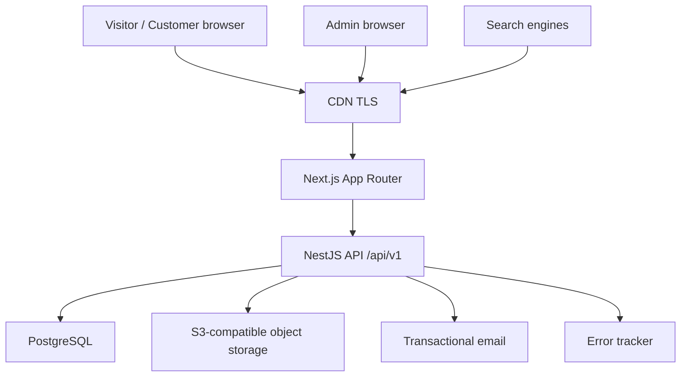
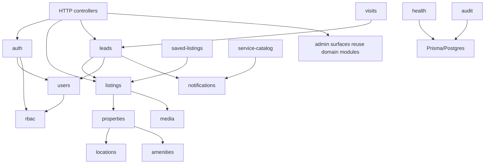
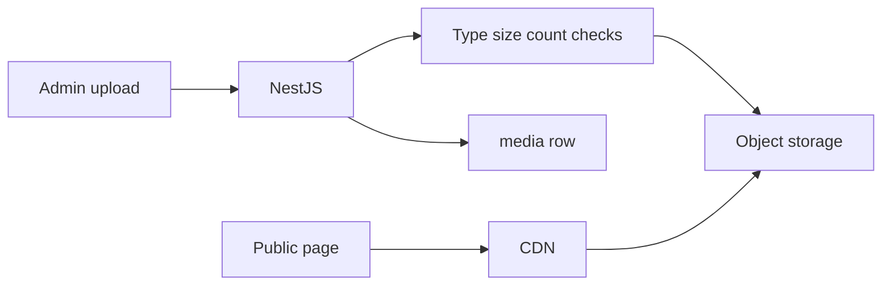

# Real Estate Platform — Architecture Design

**Document:** Deliverable 04 / Step 4  
**Depends on:** `docs/01-system-design-master.md`, `docs/02-requirements-specification.md`, `docs/03-traffic-capacity.md`  
**Status:** Corrected — Architecture Freeze v1  
**Date:** 2026-09-26  
**Sizing basis:** Scenario A with headroom to low Scenario B  
**Out of this document:** Full DDL, OpenAPI catalog, application code, frontend folder tree

---

## 1. Goals and constraints

**Goals**

- One production-grade path: public discovery → enquiry → internal lead inbox  
- SEO-capable public pages  
- Clear module boundaries in a single NestJS process  
- Cost and ops fit a solo operator  

**Constraints**

- Stack: Next.js, NestJS, PostgreSQL, TypeScript  
- Modular monolith, not microservices  
- No Kubernetes, Kafka, Elasticsearch, service mesh, multi-region  
- Redis / BullMQ only if a concrete job appears (default: not in MVP)  
- Next.js does not own domain rules; NestJS does  

---

## 2. System context



External systems in MVP: email provider, object storage, optional maps tiles/SDK, error tracker, uptime ping.  
Not in MVP: payment gateway, WhatsApp Business API, SMS OTP provider, OpenSearch.

---

## 3. Deployable units (MVP)

| Unit | Responsibility | Scale unit |
| --- | --- | --- |
| `web` | Next.js: public SSR/SSG, admin SPA-like routes, SEO | 1 (Vercel or node) |
| `api` | NestJS modular monolith | 1 process |
| `postgres` | Source of truth | 1 managed primary |
| `object-storage` | Images | Managed bucket |
| `cdn` | Public assets and images | Provider edge |

No separate worker process in MVP. Email send runs in-request after commit, failures logged. If email latency becomes a problem, extract a worker then — not now.

---

## 4. Request paths

### 4.1 Public listing detail (read, SEO-critical)

1. CDN → Next.js  
2. Server Component calls NestJS `GET /api/v1/listings/:slug` (or a public DTO endpoint)  
3. NestJS reads Postgres, returns listing+property+media  
4. Next.js renders HTML with metadata  
5. Images load from CDN/object storage, not from the API  

Do not scrape Postgres from Next.js directly. One data plane.

### 4.2 Public search

1. Next.js server or client calls `GET /api/v1/listings?...filters`  
2. API applies published-only + filters + pagination  
3. First page of home/latest may be cached at Next.js `revalidate` (ISR) for 60–300 seconds  

ISR is allowed for **public published data**. Do not ISR admin or lead data.

### 4.3 Enquiry (write)

1. Browser POST `/api/v1/leads` (browser may call API via Next rewrite `/api` → NestJS)  
2. Validate, rate limit, duplicate window, insert lead  
3. Commit  
4. Best-effort email  
5. Return 201/200 with opaque id  

Reverse proxy: frontend `/api` → NestJS (single public origin). Avoid CORS in production.

### 4.4 Admin mutation

Cookie or bearer to NestJS. RBAC guard. Audit log row. Invalidate listing cache tags if using ISR (`revalidateTag('listings')` or time-based TTL).

---

## 5. Frontend architecture (Next.js)

### 5.1 Router split

| Area | Rendering | Auth |
| --- | --- | --- |
| `/` `/buy/...` `/rent/...` `/services/...` | RSC + SSR/ISR | Public |
| `/login` `/register` `/account/...` | RSC + client forms | Customer |
| `/admin/...` | Client-heavy dashboard | Staff, `noindex` |

App Router. Route groups: `(public)`, `(auth)`, `(admin)`.

### 5.2 Server vs client

- Server Components: listing pages, search results first paint, metadata  
- Client Components: filter widgets, enquiry form, admin tables, upload  
- Server Actions: **not** for domain writes that bypass NestJS. Optional thin BFF that still calls NestJS. Prefer browser/RSC fetch to `/api/v1`.  

### 5.3 State

- Public: URL query string is the search state (shareable, SEO-friendly)  
- Admin: TanStack Query for server state  
- No Redux  
- Zustand only if admin wizard complexity demands it (default no)  
- Forms: React Hook Form + Zod matching API validation  

### 5.4 Auth on the web

- Next.js middleware: protect `/admin` and `/account` by presence of session cookie; **does not** replace API RBAC  
- Session: httpOnly refresh cookie on API domain/path; access token memory or short cookie  
- Staff and customer share identity service; UI shells differ  

### 5.5 Images

- `next/image` with remote patterns allowlisting the bucket/CDN host  
- Listing cover + gallery from object URLs  
- OG images: cover URL in metadata  

### 5.6 SEO mechanics

- `generateMetadata` per listing  
- `sitemap.ts` from published listing API or direct build-time fetch  
- Canonical + OpenGraph  
- Locality pages only when listings exist (P1 if week 5 slips)  

### 5.7 Error/loading

- `loading.tsx` / `not-found.tsx` for public routes  
- Enquiry form: field errors from `VALIDATION_ERROR`  
- Never show stack traces  

---

## 6. Backend architecture (NestJS modular monolith)

### 6.1 Module map



Dependency rule: arrows point to dependencies. **Never** `listings` import `leads`. **Never** `notifications` import `leads` (receive a DTO/command).

### 6.2 Module contents (pattern)

Each domain module:

- `*.module.ts`  
- `*.controller.ts` — HTTP only  
- `*.service.ts` — business rules  
- `*.repository.ts` — Prisma access (optional wrapper; Prisma in service is OK if queries stay here)  
- `dto/` — input/output  
- guards used globally: `JwtAuthGuard`, `PermissionsGuard`  

No giant `AppService`.

### 6.3 Cross-cutting NestJS

| Mechanism | Use |
| --- | --- |
| ValidationPipe / Zod pipe | All bodies and queries |
| Guards | Authn then Authz |
| Interceptor | Request id, audit for mutations, response wrap optional |
| Exception filter | Map domain errors to error catalog |
| Logger | Pino or Nest JSON logger |

### 6.4 Transactions

Use Prisma `$transaction` for: publish checks (listing + image count), lead duplicate check+insert, visit create that may insert lead.

Keep transactions short. Do not send email inside the DB transaction.

### 6.5 Events (in-process only)

Optional Nest `EventEmitter` for `lead.created` → notification listener. Not Kafka. If used, still same process; lost on crash after commit is acceptable for email (ops can resend). Prefer explicit service call after commit for MVP simplicity.

**Recommendation:** explicit `notificationService.send` after commit. Fewer moving parts.

---

## 7. Data architecture

- PostgreSQL is the system of record for all P0 entities  
- Object storage holds bytes; `media` table holds keys and metadata  
- No data lake  
- Analytics events table in Postgres (append-only). Volume at Scenario A is trivial.  
- Cache: Next.js ISR / `Cache-Control` on public GET. Application Redis: not in MVP  

Read models: listing search is a SQL query with joins (listing + property + city + locality + cover media). Not a separate denormalized table until proven slow.

---

## 8. Search architecture (Postgres)

Pipeline:

1. Restrict `listings.status = PUBLISHED` AND `deleted_at IS NULL`  
2. Equality filters: intent, city, locality, type, bedrooms, furnishing  
3. Range: price, area  
4. Optional `q`: `ILIKE` or `pg_trgm` / `tsvector` on title  
5. Sort whitelist  
6. `LIMIT/OFFSET` with `pageSize <= 24`  

Indexes: named in later schema doc; architecture requires composite indexes matching default filters.

Geo: store lat/lng; no radius query in P0. Map pin is display-only.

---

## 9. Media architecture



- Upload via API (multipart) or presigned PUT. **Recommendation: multipart through API for MVP** (simpler auth, size checks). Presign at P1 if payloads hurt the API.  
- Path key: `listings/{listingId}/{uuid}.jpg`  
- Variants: optional `sharp` resize to card (e.g. 600w) and detail (1600w) on upload, sync, Scenario A volume is fine. If upload time > 5s regularly, move to queue later.  
- Public-read for listing images. No public-read for future private docs.

---

## 10. Authn / Authz architecture

```text
User --has--> UserRole --has--> Role --has--> RolePermission --has--> Permission
```

- JWT access (short) contains `sub` + `roles` for convenience  
- Every privileged request: load permissions from DB or a short in-memory cache per process; **do not trust role in JWT as the only check** if roles can change (reload permissions on each request at Scenario A is cheap)  
- Resource checks in services (ownership), not a generic ACL engine  

Refresh tokens stored hashed in DB for revocation.

---

## 11. Notification architecture

`NotificationService.send({ template, to, data })`  

P0 provider: one email adapter (Resend/SES/Postmark). Interface: `EmailPort`. Swap provider without touching leads.

Log: `notification_log` (template, to masked, status, provider id, error).

SMS/WhatsApp ports exist as **interfaces not implemented**.

---

## 12. Caching policy

| Data | Cache? | Where | TTL | Invalidation |
| --- | --- | --- | --- | --- |
| Published listing detail | Yes | Next ISR or Cache-Control | 60–300 s | On publish/pause/update |
| Search results | Optional short | Next or CDN | 30–60 s | TTL only |
| Locality list | Yes | API memory or Next | 10 min | Admin locality change rare |
| Leads, me, admin lists | **No** | | | |
| Permissions | Optional | Process memory | 30 s | TTL |

No cache stampede design needed at 1 RPS.

---

## 13. Rate limiting

Single API instance: in-memory token bucket keyed by IP and by phone/email where relevant. Document that a second instance requires Redis. Health checks excluded.

---

## 14. Security architecture (placement)

| Control | Where |
| --- | --- |
| TLS | CDN / reverse proxy |
| Security headers | Next.js + API (`X-Content-Type-Options`, frame deny, CSP on web) |
| Validation | Nest pipes |
| Authn/z | Guards + service checks |
| Upload allowlist | Media service |
| Rate limit | Middleware |
| Secrets | Env / platform store |
| Audit | Interceptor or service on admin writes |
| CORS | Tight; same-origin via rewrite preferred |

---

## 15. Observability and health

- JSON logs with `requestId`  
- Sentry on `web` and `api`  
- `GET /health` process up  
- `GET /ready` Postgres ping  
- Uptime check on public `/health` or home  

No distributed tracing in MVP.

---

## 16. Environments and config

| Key examples | Dev | Staging | Prod |
| --- | --- | --- | --- |
| `DATABASE_URL` | local compose | isolated | isolated |
| `S3_*` | MinIO | bucket | bucket |
| `JWT_*` | local secrets | distinct | distinct |
| `MAIL_*` | ethereal/mailhog | provider sandbox | provider |
| `PUBLIC_APP_URL` | localhost | staging host | prod host |
| `OPS_INBOX_EMAIL` | your inbox | | |

Never commit `.env`. Provide `.env.example` with placeholders only.

---

## 17. Deployment architecture (proposed)

**Recommended**

- `web`: Vercel, `allowedHosts` / platform hostnames as needed  
- `api`: Docker on a small VPS or PaaS, behind Nginx/Caddy  
- `postgres`: managed with daily backups  
- Bucket + CDN for media  

**Acceptable cheaper**

- Docker Compose on one VPS: `web`, `api`, `minio` or external bucket, **managed Postgres still preferred**  

CI: lint → typecheck → unit → build → deploy staging on main/staging branch → manual prod promote.

Migrations: run as a release step (`prisma migrate deploy`) before new API starts.

---

## 18. Failure modes

| Failure | User impact | Mitigation |
| --- | --- | --- |
| Email provider down | Lead still saved | Log; ops sees inbox gap |
| Object storage down | Upload fails; reads if CDN cached | Fail upload loudly |
| Postgres down | Site down | Managed HA later; not MVP |
| API down, Next up | HTML may fail data | Show error; do not serve stale private data |
| Abuse traffic | Enquiry spam | Rate limits, later captcha |

RPO/RTO: see master doc — daily backup, restore drill week 8.

---

## 19. Evolution (do not build now)

| Stage | Change |
| --- | --- |
| 1 (now) | Modular monolith as above |
| 2 | Redis + second API + CDN everywhere |
| 3 | BullMQ worker for images/email |
| 4 | OpenSearch if search proven insufficient |
| 5 | Extract notification or media service if team/load splits |

Extraction candidates later: search, media processing, notifications. Not before data says so.

---

## 20. Repository structure (proposed, not scaffolding)

```text
apps/web/          Next.js
apps/api/          NestJS
packages/types/    shared Zod/DTO types later
packages/config/   eslint prettier tsconfig
docs/              this design set
infra/             compose, nginx snippets later
```

Monorepo (D16 default). Two repos acceptable if tooling pain exceeds benefit.

---

## 21. Architecture review checklist (this step)

- MVP boundaries respected: yes  
- NestJS module arrows acyclic: yes  
- Postgres is search: yes  
- Images not in DB: yes  
- Next not owning domain: yes  
- Sized for Scenario A with 5–10 RPS burst headroom and a path to ~30 RPS before dedicated search: yes  
- Payments/brokers/ES/K8s absent: yes  

---

## 22. Next

Step 5 — Domain model (`docs/05-domain-model.md`), then Step 6 schema after that review.
