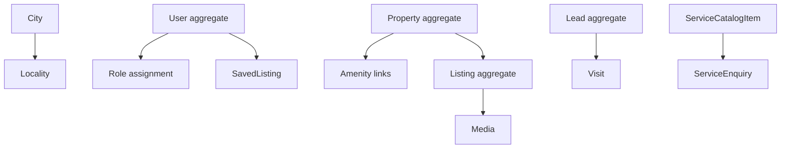
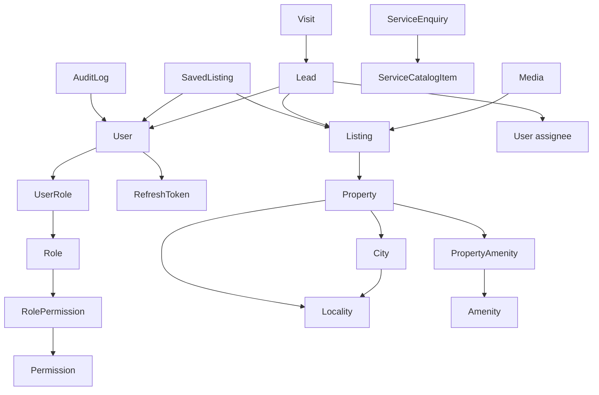

# Real Estate Platform — Domain Model

**Document:** Deliverable 05 / Step 5  
**Depends on:** `docs/01-system-design-master.md`, `docs/02-requirements-specification.md`, `docs/04-architecture.md`  
**Status:** Corrected — aligned with Architecture Freeze v1  
**Date:** 2026-09-26  
**Out of this document:** Full PostgreSQL DDL, indexes SQL, Prisma schema file, application code

This is the conceptual model. Step 6 will map it to tables. Entities listed as **P0** are in the first schema. Entities listed as **deferred** must not appear in MVP migrations.

---

## 1. Ubiquitous language

| Term | Meaning |
| --- | --- |
| Property | The real-world asset (flat, shop, plot). Physical facts. Not a URL. |
| Listing | A commercial offer on a property (buy or rent). Has price, status, slug, public page. |
| Locality | Neighbourhood inside a city (e.g. Sector 62, Noida). Controlled vocabulary. |
| Lead | A captured enquiry with a phone number. Work item for staff. |
| Visit | A requested or confirmed site visit, always tied to a lead. |
| Customer | A registered user with role CUSTOMER. |
| Staff | Admin, Super Admin, or Sales Agent. |
| Intent | `BUY` or `RENT` on a listing. |
| Publish | Transition that makes a listing publicly searchable. |

Do not say “property page” in code or docs when you mean listing page.

---

## 2. Bounded contexts (modules, one database)

One Postgres database. Boundaries are NestJS modules, not services.

| Context | Owns | May refer to |
| --- | --- | --- |
| Identity | User, Role, Permission, refresh tokens, password reset tokens | — |
| Locations | City, Locality | — |
| Inventory | Property, Listing, Amenity, Media | Locations, Identity (audit actor) |
| Demand | Lead, LeadNote (optional), SavedListing, Visit | Inventory listing id, Identity user id |
| Services marketing | ServiceCatalogItem, ServiceEnquiry | — |
| Platform | AuditLog, AnalyticsEvent, NotificationLog | ids only |

**Demand must not be imported by Inventory.** Inventory does not know that leads exist.

---

## 3. Aggregate map (P0)

Aggregates are consistency boundaries for transactions.



| Aggregate root | Contained | Invariants |
| --- | --- | --- |
| User | roles, refresh tokens | unique email, unique phone; public register ⇒ CUSTOMER only |
| City | — | unique slug |
| Locality | — | unique slug per city |
| Property | property_amenities | locality required before any listing can publish |
| Listing | media (or media as child) | at most one PUBLISHED listing per (property, intent); publish requires images, price, title, property locality |
| Lead | visits (or visit references lead) | duplicate phone+listing within 24h does not create a second root |
| ServiceCatalogItem | — | unique slug |
| ServiceEnquiry | — | independent of property leads |

**Media:** treat as child of Listing for MVP (all P0 photos hang off listings). Property-level media can wait.

**Visit:** not its own aggregate; it is a child of Lead (every visit creates or attaches a lead). Alternative: Visit as root pointing at Lead. **Recommendation: Visit is a child entity of Lead** so inbox remains the source of truth.

---

## 4. Entity dictionary (P0)

### 4.1 User

Identity for login. Not the same as a Lead snapshot.

| Attribute (conceptual) | Notes |
| --- | --- |
| id | UUID public |
| email | globally unique including soft-deleted; required for P0 auth |
| phone | globally unique including soft-deleted; E.164 required |
| password hash | never returned |
| name | |
| status | ACTIVE, LOCKED, DISABLED |
| failed login count / lock until | |
| email verified at | nullable; P0 may stay null |
| timestamps | created, updated, deleted (soft) |

Related: UserRole, RefreshToken, PasswordResetToken.

Email and phone are never reused after soft delete. Login against a soft-deleted user returns the same generic invalid-credentials error as unknown email.

### 4.2 Role and Permission

Seeded. Not user-editable catalogs in P0 except Super Admin assigning roles to staff.

- Role: code (`CUSTOMER`, `ADMIN`, …), name  
- Permission: code (`lead.read_all`, …)  
- RolePermission, UserRole  

### 4.3 RefreshToken

Hashed token, user id, expires at, revoked at. Rotation: insert new, revoke old. All rows for a user are revoked on password reset.

### 4.3b PasswordResetToken

Hashed one-time token, user_id, expires_at (1 hour), used_at nullable. Never store plaintext. Success: mark used, change password, revoke all refresh tokens, clear lockout.

### 4.4 City

id, name, slug, is_active, timestamps.

### 4.5 Locality

id, city_id, name, slug, is_active, optional centroid lat/lng, timestamps.

### 4.6 Amenity

id, code, name, is_active. Seeded. Many-to-many with Property.

### 4.7 Property

Physical asset.

| Attribute | Notes |
| --- | --- |
| id | UUID |
| type | RESIDENTIAL, COMMERCIAL, PLOT |
| city_id, locality_id | required on property row; DB composite FK guarantees locality belongs to city |
| society_name | string, optional |
| address_text | optional |
| lat, lng | optional |
| area_value, area_unit | SQFT default; at least one area to publish |
| bedrooms, bathrooms, balconies | nullable; 0 bedroom allowed |
| floor, total_floors | nullable |
| furnishing | UNFURNISHED, SEMI, FURNISHED, null |
| facing, age_years, parking_count | optional |
| status | ACTIVE, ARCHIVED |
| internal_title | staff-facing |
| deleted_at | soft |

Invariants: type in enum; area_value > 0 if set; **locality.city_id matches city_id enforced by composite FK, not only application code.** No `is_new_project` attribute in MVP.

### 4.8 Listing

Commercial offer. **Public identity of inventory.**

| Attribute | Notes |
| --- | --- |
| id | UUID |
| property_id | required |
| intent | BUY, RENT |
| status | DRAFT, PUBLISHED, PAUSED, CLOSED |
| title | marketing |
| description | plain text / safe markdown |
| slug | unique among not deleted; **immutable after first PUBLISHED** |
| price_amount | integer INR, > 0 to publish |
| price_period | MONTHLY for rent; ONE_TIME for buy |
| maintenance_amount | optional |
| deposit_amount | rent optional |
| negotiable | boolean |
| available_from | optional date |
| published_at | set on first publish |
| closed_at | |
| deleted_at | |

Invariants:

- Unique published: one PUBLISHED row per (property_id, intent) among not deleted.  
- Publish: title, price > 0, ≥1 media, property has locality and type and area.  
- Public read only if status = PUBLISHED and deleted_at null.

### 4.9 Media

| Attribute | Notes |
| --- | --- |
| id | UUID |
| listing_id | required in P0 |
| storage_key | bucket path |
| content_type | image/jpeg, image/png, image/webp |
| bytes | size |
| width, height | optional until processed |
| sort_order | 0 = cover |
| variant | ORIGINAL, CARD, DETAIL (if variants exist) |

Cover = lowest sort_order among ORIGINAL (or CARD for cards). Cap: **20 ORIGINAL** per listing; CARD/DETAIL do not count.

### 4.10 Lead

| Attribute | Notes |
| --- | --- |
| id | UUID |
| listing_id | nullable only for contact-form leads |
| user_id | nullable (guest) |
| assigned_to_user_id | nullable |
| name, phone, email | snapshot; phone required |
| message | optional |
| status | NEW, CONTACTED, QUALIFIED, UNQUALIFIED, VISIT_SCHEDULED, WON, LOST, SPAM |
| source | WEB_FORM, CONTACT_FORM, … |
| created_at, updated_at | no soft delete; use SPAM |

Duplicate window: same phone + listing_id within 24h and status not SPAM/LOST/WON → return existing. Implemented as a transaction. **Rare concurrent duplicates are an accepted P0 trade-off** (no Redis, no DB unique on the window).

### 4.11 Visit (child of Lead)

| Attribute | Notes |
| --- | --- |
| id | UUID |
| lead_id | required |
| listing_id | required for visits; **must equal lead.listing_id** in the same transaction |
| preferred_date | optional |
| preferred_slot | ANY, MORNING, AFTERNOON, EVENING |
| status | REQUESTED, CONFIRMED, COMPLETED, NO_SHOW, CANCELLED |
| notes | |

If module is cut in week 7, this entity is omitted from schema.

### 4.12 SavedListing

user_id + listing_id unique. Max 100 per user (application rule).

### 4.13 ServiceCatalogItem

slug, title, summary, is_active, sort_order.

### 4.14 ServiceEnquiry

name, phone, email, catalog item, message, city optional, **status NEW | CONTACTED** (own enum, not LeadStatus). Admin may set NEW → CONTACTED only. created_at, updated_at.

### 4.15 AuditLog

actor_user_id, action, entity_type, entity_id, metadata JSON (no secrets), created_at. Append-only.

### 4.16 AnalyticsEvent

name, properties JSON (no full PII), listing_id optional, user_id optional, request_id, created_at. Append-only.

### 4.17 NotificationLog

template, channel EMAIL, to_hash or masked to, status SENT/FAILED, provider_message_id, error, created_at.

---

## 5. Enumerations (P0)

Lock these names in schema and API.

```text
UserStatus:        ACTIVE | LOCKED | DISABLED
PropertyType:      RESIDENTIAL | COMMERCIAL | PLOT
PropertyStatus:    ACTIVE | ARCHIVED
Furnishing:        UNFURNISHED | SEMI | FURNISHED
AreaUnit:          SQFT
ListingIntent:     BUY | RENT
ListingStatus:     DRAFT | PUBLISHED | PAUSED | CLOSED
PricePeriod:       MONTHLY | ONE_TIME
LeadStatus:        NEW | CONTACTED | QUALIFIED | UNQUALIFIED | VISIT_SCHEDULED | WON | LOST | SPAM
LeadSource:        WEB_FORM | CONTACT_FORM | ADMIN
VisitStatus:       REQUESTED | CONFIRMED | COMPLETED | NO_SHOW | CANCELLED
VisitSlot:         ANY | MORNING | AFTERNOON | EVENING
MediaVariant:      ORIGINAL | CARD | DETAIL
NotificationChannel: EMAIL
NotificationStatus: PENDING | SENT | FAILED
ServiceEnquiryStatus: NEW | CONTACTED
```

---

## 6. Relationships



Cardinality:

- City 1—* Locality  
- Property *—1 Locality, *—1 City  
- Property 1—* Listing  
- Listing 1—* Media  
- Listing 1—* Lead  
- User 1—* Lead (as customer or as assignee)  
- Lead 1—* Visit  
- User *—* Listing via SavedListing  

---

## 7. State machines

### 7.1 Listing

```text
DRAFT --publish--> PUBLISHED
PUBLISHED --pause--> PAUSED
PAUSED --resume--> PUBLISHED
PUBLISHED --close--> CLOSED
PAUSED --close--> CLOSED
DRAFT --soft_delete--> (deleted)
```

CLOSED and deleted are not public. No reopen in P0 (P1: reopen CLOSED → DRAFT).

Publish command validates invariants; it is not a simple status patch.

### 7.2 Lead

```text
NEW --> CONTACTED | SPAM | LOST
CONTACTED --> QUALIFIED | UNQUALIFIED | LOST | SPAM
QUALIFIED --> VISIT_SCHEDULED | LOST
UNQUALIFIED --> LOST | CONTACTED
VISIT_SCHEDULED --> WON | LOST | QUALIFIED
```

WON, LOST, SPAM are terminal for P0 (no further staff workflow). Admin may still read.

### 7.3 Visit

```text
REQUESTED --> CONFIRMED | CANCELLED
CONFIRMED --> COMPLETED | NO_SHOW | CANCELLED
```

On CONFIRMED, set parent lead status to VISIT_SCHEDULED if not terminal.

---

## 8. Domain services / commands (not HTTP)

Named so API/application layers stay thin.

| Command | Actor | Effect |
| --- | --- | --- |
| RegisterCustomer | Visitor | User + CUSTOMER role |
| Login | User | Tokens |
| CreateProperty | Admin | Property DRAFT-like ACTIVE |
| UpdateProperty | Admin | Block if would break published listing invariants |
| CreateListing | Admin | Listing DRAFT |
| AddMedia | Admin | Media row + object |
| PublishListing | Admin | Status PUBLISHED or reject |
| PauseListing / CloseListing | Admin | Hide |
| CreateLead | Visitor/Customer | Insert or return existing duplicate |
| AssignLead | Admin | assigned_to |
| ChangeLeadStatus | Admin/Agent | Allowed transitions |
| SaveListing | Customer | Upsert saved |
| CreateVisit | Customer | Visit + maybe lead |
| CreateServiceEnquiry | Visitor | Row + email |

Queries: SearchPublishedListings, GetPublishedListingBySlug, ListLeadsForStaff, GetMyLeads, AdminDashboardCounts.

---

## 9. Invariants checklist (must survive schema)

1. Property ≠ Listing; public URL is listing slug.  
2. ≤1 PUBLISHED listing per property+intent.  
3. Publish requires images, price, title, locality, area.  
4. Guest lead has user_id null; phone still required.  
5. Customer cannot read another customer’s lead (same 404).  
6. Agent cannot read unassigned leads.  
7. Public register cannot assign ADMIN.  
8. Slug unique and immutable after first publish.  
9. No owner PII on listing public DTO.  
10. Media bytes never in Postgres.  
11. Email failure does not delete the lead.  
12. Soft-deleted listings excluded from search and slug lookup.

---

## 10. Explicitly not in the domain (P0)

Do not model: Broker, Owner portal, Commission, Transaction, TokenPayment, Quotation, WorkOrder, ServiceProvider, Review, Document/KYC, PropertyUnit, FollowUp table, Society master, Country/State tree, Chat, Subscription.

LeadNote: skip if messages live on lead.message only; add in P1 if staff need a thread.

---

## 11. ID strategy

- Public entities: UUID (v4 or v7). Prevents easy enumeration of leads.  
- Listing URLs use **slug**, not UUID.  
- Seeded masters (roles, amenities, cities): UUID or stable slug codes; slug/code is the human key.

Approval still open (D11); this model assumes UUID.

---

## 12. Mapping to NestJS modules

| Module | Roots |
| --- | --- |
| `auth` + `users` + `rbac` | User, Role, Permission, RefreshToken, PasswordResetToken |
| `locations` | City, Locality |
| `properties` | Property, Amenity |
| `listings` | Listing |
| `media` | Media |
| `leads` | Lead, Visit |
| `saved-listings` | SavedListing |
| `service-catalog` | ServiceCatalogItem, ServiceEnquiry |
| `notifications` | NotificationLog |
| `audit` | AuditLog |
| `analytics` | AnalyticsEvent |

---

## 13. Open domain questions

1. Contact form lead with `listing_id` null — keep as Lead or only ServiceEnquiry-style ContactMessage? **Default: Lead with listing_id null and source CONTACT_FORM.**  
2. Include Visit in first migration or delay until week 7? **Default: include table, ship UI if time.**  
3. Store listing description as markdown vs plain text? **Default: plain text.**  

---

## 14. Next

Step 6 — Detailed PostgreSQL schema (`docs/06-database-schema.md`): tables, columns, constraints, indexes, soft delete, UUID. Still no application code.

**End of Deliverable 05.**
