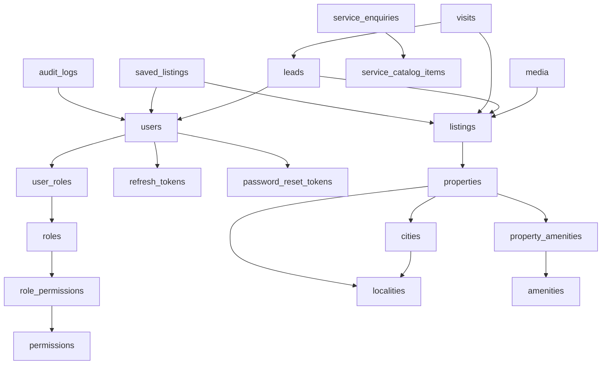

# DELIVERABLE 23 — FINAL POSTGRESQL SCHEMA & PRISMA DESIGN

**File:** `docs/24-final-postgresql-prisma-design.md`  
(Folder number 24 because `docs/23-correction-pass.md` already exists.)  
**Depends on:** `docs/00-architecture-freeze.md`, corrected Deliverables 05–06, 10–12, 15–16, 18, 22  
**Date:** 2026-09-26  
**Revision:** Database correction pass (D23-C1–C7) — still **no** application code  
**Out of this document:** NestJS/Next.js code, Docker, GitHub Actions, Prisma Client query code, runnable migration files in `apps/`

If this file disagrees with older drafts, **this file + Architecture Freeze v1** win.

Money refinement vs freeze “integer INR”: columns use **`bigint`** (whole rupees, no paise, no float). Same meaning, wider type. API JSON representation is defined in section 29 (number, not PostgreSQL type change).

Lead assignee column remains **`assigned_to_user_id`** (freeze). Prisma relation name: `assignee`.

**ORM pin:** Prisma ORM **6.x** with `prisma-client-js` and `url = env("DATABASE_URL")` in the schema datasource (not Prisma 7 config-file datasource). Nested NestJS remains compatible. Composite multi-field `@relation` is valid on this line.

---

## 1. Document Status

Authoritative database blueprint for the NestJS modular monolith. Not an implementation go-ahead for application code.

No contradictions found that block schema. Open items in section 26 are non-blocking (seed locality list, super-admin bootstrap secret).

Correction pass D23-C1–C7 applied in this file: ORIGINAL media cap, published-only search indexes, user lock state machine, append-only table grants, Prisma composite FK authority, BigInt JSON mapping, media upload/orphan sequence.

---

## 2. Database Architecture

```text
Next.js  →  NestJS modular monolith  →  ONE PostgreSQL 16.x
                                      →  Object storage (image bytes)
```

- Prisma ORM + explicit SQL migrations where Prisma cannot express a feature  
- One primary, no replica in MVP, no Redis, no search cluster, no sharding  
- UTC `timestamptz`  
- UUID primary keys: **PostgreSQL `gen_random_uuid()` only** (PG 16 built-in; no extra extension). Prisma `@default(dbgenerated("gen_random_uuid()"))`. Do not also generate IDs in application code for table PKs. Media object keys remain app-generated UUIDs (storage, not row PKs).  
- Application connects with a least-privilege role; migrations use a separate role  

---

## 3. Design Principles

- `snake_case` tables and columns  
- Foreign keys for real relationships  
- UNIQUE/CHECK/partial indexes for **database** invariants only  
- JSONB only on `audit_logs.metadata` and `analytics_events.properties`  
- Soft delete only on `users`, `properties`, `listings`  
- Do not over-index  
- Do not weaken PostgreSQL to fit Prisma  

---

## 4. Entity Inventory

| Table | Context | Soft delete |
| --- | --- | --- |
| users | Identity | yes |
| password_reset_tokens | Identity | no |
| roles | Identity | no |
| permissions | Identity | no |
| role_permissions | Identity | no |
| user_roles | Identity | no |
| refresh_tokens | Identity | no |
| cities | Locations | no |
| localities | Locations | no |
| amenities | Inventory | no |
| properties | Inventory | yes |
| property_amenities | Inventory | no |
| listings | Inventory | yes |
| media | Inventory | no (CASCADE with listing) |
| leads | Demand | no |
| visits | Demand | no |
| saved_listings | Demand | no |
| service_catalog_items | Services | no |
| service_enquiries | Services | no |
| audit_logs | Platform | no (append-only) |
| analytics_events | Platform | no (append-only) |
| notification_logs | Platform | no (append-only) |

**22 tables. No deferred entities.**

---

## 5. Relationship Overview



Cardinality: City 1—* Locality; Property *—1 Locality and City; Property 1—* Listing; Listing 1—* Media; Listing 1—* Lead; Lead 1—* Visit; User *—* Listing via SavedListing.

---

## 6. Identity Schema

### 6.1 `users`

| Column | Type | Null | Default | Constraints |
| --- | --- | --- | --- | --- |
| id | uuid | NO | gen_random_uuid() | PK |
| email | varchar(255) | NO | | UNIQUE (unconditional) |
| phone | varchar(20) | NO | | UNIQUE (unconditional) |
| password_hash | varchar(255) | NO | | never select in APIs |
| name | varchar(80) | NO | | |
| status | user_status | NO | ACTIVE | enum: ACTIVE, LOCKED, DISABLED |
| failed_login_count | integer | NO | 0 | CHECK >= 0 |
| locked_until | timestamptz | YES | NULL | temporary lock expiry |
| email_verified_at | timestamptz | YES | NULL | unused for login in P0 |
| created_at | timestamptz | NO | now() | |
| updated_at | timestamptz | NO | now() | |
| deleted_at | timestamptz | YES | NULL | |

**Global uniqueness:** `UNIQUE (email)` and `UNIQUE (phone)` with **no** `WHERE deleted_at IS NULL`. Soft-deleted rows still occupy the identity. PostgreSQL rejects `INSERT` of a reused email/phone with unique_violation.

Email stored lowercase in application before write. Phone E.164 (`+91...`). Login against `deleted_at IS NOT NULL` returns generic invalid credentials.

Security: hash Argon2id (or bcrypt ≥12). Never log this row’s hash.

Indexes: PK, unique email, unique phone. No extra.

**Lock / unlock state machine (application; columns only — no extra table):**

Threshold: **10** consecutive failed authentications against that email. Duration: **15 minutes**. Generic invalid-credentials message in all reject paths (do not leak existence, lock, or DISABLED).

| Event | `status` | `failed_login_count` | `locked_until` |
| --- | --- | --- | --- |
| Failed login (ACTIVE, not currently locked) | unchanged until threshold | increment | unchanged until threshold |
| Failed login reaches threshold | `LOCKED` | increment (typically 10) | `now() + 15 minutes` |
| Login while `status = LOCKED` and `locked_until > now()` | unchanged | unchanged | unchanged; reject |
| Login while temporary lock **expired** (`LOCKED` and `locked_until <= now()`) | set `ACTIVE` **before** credential check proceeds | set `0` | set `NULL` |
| Successful login (and not DISABLED) | `ACTIVE` | `0` | `NULL` |
| Password reset success | `ACTIVE` **unless** the account was `DISABLED` (see below) | `0` | `NULL` |
| Admin/ops explicit disable | `DISABLED` | n/a | n/a |
| `DISABLED` user attempts login or auto-unlock | **never** auto-reactivate | unchanged by login | unchanged by login |

Rules:

1. `DISABLED` is staff/ops only. Login, lock expiry, and password reset **must not** set `DISABLED` → `ACTIVE`. Reset may still rotate the hash and revoke refresh tokens so stolen sessions die; the account remains unusable until an admin sets `ACTIVE`.
2. Temporary lock uses **both** `status = LOCKED` and `locked_until`. Treat `LOCKED` with null/expired `locked_until` as expired and clear it on the next auth attempt.
3. Do not auto-unlock `DISABLED`.
4. Unknown email: do not create a user; still return generic error. Known email wrong password: increment as above.
5. Successful login never reactivates `DISABLED`.

### 6.2 `password_reset_tokens`

| Column | Type | Null | Default | Constraints |
| --- | --- | --- | --- | --- |
| id | uuid | NO | gen_random_uuid() | PK |
| user_id | uuid | NO | | FK users ON DELETE CASCADE |
| token_hash | varchar(255) | NO | | UNIQUE |
| expires_at | timestamptz | NO | | |
| used_at | timestamptz | YES | NULL | |
| created_at | timestamptz | NO | now() | |

Plaintext token never stored. Valid use: hash match AND `expires_at > now()` AND `used_at IS NULL`. Indexes: unique `token_hash` (lookup), `(user_id, created_at DESC)` (invalidate prior unused), `expires_at` (cleanup).

### 6.3 `refresh_tokens`

| Column | Type | Null | Default | Constraints |
| --- | --- | --- | --- | --- |
| id | uuid | NO | gen_random_uuid() | PK |
| user_id | uuid | NO | | FK users ON DELETE CASCADE |
| token_hash | varchar(255) | NO | | UNIQUE |
| expires_at | timestamptz | NO | | |
| revoked_at | timestamptz | YES | NULL | |
| created_at | timestamptz | NO | now() | |

Opaque random token, SHA-256 stored. Rotation: insert new, set old `revoked_at`. Password reset: `UPDATE ... SET revoked_at = now() WHERE user_id = $1 AND revoked_at IS NULL`. Cleanup: delete rows with `expires_at < now() - interval '7 days'` (ops/cron, not app queue). Index: unique hash, `(user_id, expires_at)`.

### 6.4 `roles`

id uuid PK; code varchar(50) UNIQUE NOT NULL; name varchar(80) NOT NULL. Seed codes: `SUPER_ADMIN`, `ADMIN`, `SALES_AGENT`, `CUSTOMER`.

### 6.5 `permissions`

id uuid PK; code varchar(80) UNIQUE NOT NULL.

Seed codes (stable contract):

```text
listing.manage
property.manage
location.manage
media.manage
lead.create
lead.read_own
lead.read_assigned
lead.read_all
lead.update_assigned
lead.update_all
lead.assign
visit.read_own
visit.manage_staff
user.manage
role.manage
audit.read
dashboard.read
```

`listing.read_public` is **not** a row (public GET uses listing status).

### 6.6 `role_permissions`

`role_id` uuid, `permission_id` uuid, PK `(role_id, permission_id)`, both FK CASCADE (seed catalog rebuild is safe; do not CASCADE roles from users).

### 6.7 `user_roles`

`user_id` uuid FK users CASCADE, `role_id` uuid FK roles RESTRICT, PK `(user_id, role_id)`. Restrict on role so a seeded role cannot be deleted while assigned.

---

## 7. Location Schema

### 7.1 `cities`

id uuid PK; name varchar(80) NOT NULL; slug varchar(80) NOT NULL UNIQUE; is_active boolean NOT NULL DEFAULT true; created_at, updated_at timestamptz NOT NULL.

Seed slugs: `delhi`, `noida`, `greater-noida`, `ghaziabad`, `gurugram`. Faridabad **not** in seed (not in P0 required city list).

### 7.2 `localities`

| Column | Type | Constraints |
| --- | --- | --- |
| id | uuid | PK |
| city_id | uuid | NOT NULL FK cities RESTRICT |
| name | varchar(120) | NOT NULL |
| slug | varchar(120) | NOT NULL |
| is_active | boolean | NOT NULL DEFAULT true |
| lat, lng | numeric(9,6) | NULL |
| created_at, updated_at | timestamptz | NOT NULL |

UNIQUE `(city_id, slug)`  
UNIQUE `(id, city_id)` — **required** for composite FK from properties  
Index `(city_id, is_active)`

---

## 8. Inventory Schema

### 8.1 `amenities`

id uuid PK; code varchar(50) UNIQUE NOT NULL; name varchar(80) NOT NULL; is_active boolean NOT NULL DEFAULT true.

### 8.2 `properties`

| Column | Type | Null | Constraints |
| --- | --- | --- | --- |
| id | uuid | NO | PK |
| type | property_type | NO | |
| status | property_status | NO | DEFAULT ACTIVE |
| city_id | uuid | NO | part of composite FK |
| locality_id | uuid | NO | part of composite FK |
| society_name | varchar(160) | YES | |
| address_text | varchar(500) | YES | |
| lat, lng | numeric(9,6) | YES | both null or both non-null CHECK |
| area_value | numeric(12,2) | YES | CHECK (area_value > 0) |
| area_unit | area_unit | NO | DEFAULT SQFT |
| bedrooms | smallint | YES | CHECK >= 0 |
| bathrooms | smallint | YES | CHECK >= 0 |
| balconies | smallint | YES | CHECK >= 0 |
| floor | smallint | YES | |
| total_floors | smallint | YES | |
| furnishing | furnishing | YES | |
| facing | varchar(30) | YES | flexible text, not enum |
| age_years | smallint | YES | CHECK >= 0 |
| parking_count | smallint | YES | CHECK >= 0 |
| internal_title | varchar(160) | NO | |
| created_at, updated_at | timestamptz | NO | |
| deleted_at | timestamptz | YES | |

**No `is_new_project`. No owner_id, broker_id, RERA, units, KYC.**

**DB city/locality integrity:**

```sql
ALTER TABLE localities
  ADD CONSTRAINT localities_id_city_id_key UNIQUE (id, city_id);

ALTER TABLE properties
  ADD CONSTRAINT properties_locality_city_fk
  FOREIGN KEY (locality_id, city_id)
  REFERENCES localities (id, city_id)
  ON DELETE RESTRICT;
```

Indexes: `(locality_id)`, `(city_id, type)`.

### 8.3 `property_amenities`

property_id uuid FK properties CASCADE; amenity_id uuid FK amenities RESTRICT; PK `(property_id, amenity_id)`.

### 8.4 `listings`

| Column | Type | Null | Constraints |
| --- | --- | --- | --- |
| id | uuid | NO | PK |
| property_id | uuid | NO | FK properties RESTRICT |
| intent | listing_intent | NO | |
| status | listing_status | NO | DEFAULT DRAFT |
| title | varchar(160) | NO | |
| description | text | NO | DEFAULT '' |
| slug | varchar(180) | NO | unique among non-deleted |
| price_amount | bigint | YES | CHECK (price_amount > 0) |
| price_period | price_period | NO | |
| maintenance_amount | bigint | YES | CHECK >= 0 |
| deposit_amount | bigint | YES | CHECK >= 0 |
| negotiable | boolean | NO | DEFAULT false |
| available_from | date | YES | |
| published_at | timestamptz | YES | |
| closed_at | timestamptz | YES | |
| created_at, updated_at | timestamptz | NO | |
| deleted_at | timestamptz | YES | |

CHECK: `(intent = 'RENT' AND price_period = 'MONTHLY') OR (intent = 'BUY' AND price_period = 'ONE_TIME')`.

**DATABASE:** partial unique one PUBLISHED per (property_id, intent); partial unique slug where deleted_at IS NULL.

**APPLICATION:** slug immutable after first PUBLISHED; publish requires images, area, price, etc.

### 8.5 `media`

| Column | Type | Constraints |
| --- | --- | --- |
| id | uuid | PK |
| listing_id | uuid | FK listings ON DELETE CASCADE |
| storage_key | varchar(500) | NOT NULL UNIQUE |
| content_type | varchar(50) | NOT NULL |
| byte_size | integer | NOT NULL CHECK > 0 |
| width, height | integer | NULL, CHECK > 0 if set |
| sort_order | integer | NOT NULL DEFAULT 0 |
| variant | media_variant | NOT NULL DEFAULT ORIGINAL |
| created_at | timestamptz | NOT NULL |

CHECK content_type IN (`image/jpeg`,`image/png`,`image/webp`) — also app magic-byte. Bytes never in Postgres. Cover = ORIGINAL with lowest sort_order (0 = cover). Index `(listing_id, variant, sort_order)`.

**ORIGINAL count vs row count (frozen):**

```text
MAX ORIGINAL MEDIA PER LISTING = 20
```

This is **not** “maximum 20 rows in `media`”. Each uploaded original may create CARD and DETAIL derivative rows.

```text
20 ORIGINAL
20 CARD
20 DETAIL
----------------
60 media rows maximum per listing
```

CARD and DETAIL **do not** count toward the 20-upload limit.

Application must enforce the cap with:

```sql
SELECT COUNT(*) FROM media
WHERE listing_id = $1
  AND variant = 'ORIGINAL';
```

Reject a new ORIGINAL when that count is already 20. Publish requires **≥ 1 ORIGINAL**. Cannot delete the last ORIGINAL of a PUBLISHED listing (409). No CHECK for “20 ORIGINAL” (cross-row count). No unique on `(listing_id, variant)` — many ORIGINALs per listing.

**Upload / orphan sequence (frozen):**

```text
1. Validate request (auth, listing exists and not deleted, MIME/magic/ext, size ≤ 8 MB, max dimension 8000px)
2. Count ORIGINAL for listing; if count >= 20 → 409/400, no storage write
3. Upload ORIGINAL object
4. Sync sharp: upload CARD object, upload DETAIL object (best-effort variants; ORIGINAL is required)
5. Insert media row(s) in one DB transaction (ORIGINAL required; CARD/DETAIL if objects exist)
6. Return public URLs
```

Failure matrix:

| After | Failure | Action |
| --- | --- | --- |
| Validation | invalid | no objects, no rows |
| ORIGINAL object uploaded | sharp/CARD/DETAIL object fails | best-effort delete ORIGINAL (and any variant objects); **fail HTTP**; no DB rows |
| All objects uploaded | DB insert fails | **best-effort delete** those objects; log leftovers as orphans; **fail HTTP**; do not return success |
| DB insert OK | HTTP already succeeding | done |
| DB media delete OK | object delete fails | log; listing consistent (row gone); GC later (P1) |

No worker pipeline in MVP. Periodic orphan GC is P1. Never leave the API in “success with missing rows”.

---

## 9. Demand Schema

### 9.1 `leads`

| Column | Type | Null | Notes |
| --- | --- | --- | --- |
| id | uuid | NO | PK |
| listing_id | uuid | YES | FK listings RESTRICT; null = CONTACT_FORM |
| user_id | uuid | YES | FK users SET NULL; guest = null |
| assigned_to_user_id | uuid | YES | FK users SET NULL |
| name | varchar(80) | NO | snapshot |
| phone | varchar(20) | NO | E.164 PII |
| email | varchar(255) | YES | |
| message | varchar(1000) | YES | |
| status | lead_status | NO | DEFAULT NEW |
| source | lead_source | NO | DEFAULT WEB_FORM |
| created_at, updated_at | timestamptz | NO | |

No `deleted_at`. Spam uses status SPAM.

24h duplicate: application transaction. **No DB unique on (phone, listing_id).** Race: rare concurrent duplicate accepted (Scenario A 2–20 leads/day). Indexes: `(status, created_at DESC)`, `(assigned_to_user_id, status, created_at DESC)`, `(user_id, created_at DESC)`, `(phone, listing_id, created_at DESC)`.

### 9.2 `visits`

id uuid PK; lead_id uuid NOT NULL FK leads RESTRICT; listing_id uuid NOT NULL FK listings RESTRICT; preferred_date date NULL; preferred_slot visit_slot NOT NULL DEFAULT ANY; status visit_status NOT NULL DEFAULT REQUESTED; notes varchar(1000) NULL; created_at, updated_at timestamptz NOT NULL.

**Invariant `visits.listing_id = leads.listing_id`:** enforced in the same application transaction as insert/update. Not a CHECK (would need a composite FK to a hypothetical unique (id, listing_id) on leads; leads.listing_id is nullable). P0: no trigger. Visits require a lead with non-null listing_id.

Index `(lead_id, created_at DESC)`, `(status, preferred_date)`.

### 9.3 `saved_listings`

user_id uuid FK users CASCADE; listing_id uuid FK listings CASCADE; created_at timestamptz NOT NULL; PK `(user_id, listing_id)`. Duplicate save impossible. Max 100 per user: **application**. Index `(user_id, created_at DESC)`.

---

## 10. Services Schema

### 10.1 `service_catalog_items`

id uuid PK; slug varchar(80) UNIQUE NOT NULL; title varchar(120) NOT NULL; summary text NOT NULL DEFAULT ''; is_active boolean NOT NULL DEFAULT true; sort_order integer NOT NULL DEFAULT 0; created_at, updated_at timestamptz NOT NULL.

### 10.2 `service_enquiries`

id uuid PK; catalog_item_id uuid NOT NULL FK service_catalog_items RESTRICT; name varchar(80) NOT NULL; phone varchar(20) NOT NULL; email varchar(255) NULL; message varchar(1000) NULL; city varchar(80) NULL; status service_enquiry_status NOT NULL DEFAULT NEW; created_at, updated_at timestamptz NOT NULL.

Do **not** reuse lead_status. P0 transition NEW → CONTACTED only (application). Index `(created_at DESC)`, `(phone, created_at DESC)`.

---

## 11. Platform Schema

### 11.1 `audit_logs`

id uuid PK; actor_user_id uuid NULL FK users ON DELETE SET NULL; action varchar(80) NOT NULL; entity_type varchar(80) NOT NULL; entity_id uuid NULL; metadata jsonb NOT NULL DEFAULT '{}'; created_at timestamptz NOT NULL.

Append-only. Runtime app role: **INSERT + SELECT only**. No UPDATE, no DELETE. Never put passwords/tokens in metadata. Indexes: `(entity_type, entity_id, created_at DESC)`, `(actor_user_id, created_at DESC)`. App code must not call Prisma `update`/`delete` on this model. Retention purge is an ops/migration-role job, not the API process.

### 11.2 `analytics_events`

id uuid PK; name varchar(80) NOT NULL; listing_id uuid NULL (**no FK** — keep event if listing removed); user_id uuid NULL no FK; properties jsonb NOT NULL DEFAULT '{}'; request_id varchar(64) NULL; created_at timestamptz NOT NULL.

No extra PII in properties. Indexes: `(name, created_at DESC)`, partial `(listing_id, created_at DESC)` WHERE listing_id IS NOT NULL.

Append-only for the API process: runtime app role **INSERT + SELECT** only (no UPDATE/DELETE). Events are facts; correcting a listing does not rewrite history. Ops purge (if ever) uses the migration/ops role.

### 11.3 `notification_logs`

id uuid PK; template varchar(80) NOT NULL; channel notification_channel NOT NULL; to_masked varchar(255) NOT NULL; status notification_status NOT NULL; provider_message_id varchar(160) NULL; error varchar(500) NULL; created_at timestamptz NOT NULL.

Index `(created_at DESC)`. No full recipient, no HTML body.

Not append-only: P0 send path inserts `PENDING` then **UPDATE**s `status` to `SENT` or `FAILED` (and provider id / error). Runtime app role needs INSERT + SELECT + UPDATE on this table; still **no DELETE**.

---

## 12. Enums

PostgreSQL enums (Prisma enums map 1:1):

| Enum | Values |
| --- | --- |
| user_status | ACTIVE, LOCKED, DISABLED |
| property_type | RESIDENTIAL, COMMERCIAL, PLOT |
| property_status | ACTIVE, ARCHIVED |
| furnishing | UNFURNISHED, SEMI, FURNISHED |
| area_unit | SQFT |
| listing_intent | BUY, RENT |
| listing_status | DRAFT, PUBLISHED, PAUSED, CLOSED |
| price_period | MONTHLY, ONE_TIME |
| lead_status | NEW, CONTACTED, QUALIFIED, UNQUALIFIED, VISIT_SCHEDULED, WON, LOST, SPAM |
| lead_source | WEB_FORM, CONTACT_FORM, ADMIN |
| visit_status | REQUESTED, CONFIRMED, COMPLETED, NO_SHOW, CANCELLED |
| visit_slot | ANY, MORNING, AFTERNOON, EVENING |
| media_variant | ORIGINAL, CARD, DETAIL |
| notification_channel | EMAIL |
| notification_status | PENDING, SENT, FAILED |
| service_enquiry_status | NEW, CONTACTED |

**VARCHAR not enum:** `roles.code`, `permissions.code` (stable but seeded strings; RBAC catalog); `facing` (open vocabulary); `audit_logs.action`, `entity_type`; `analytics_events.name`; `notification_logs.template`; `media.content_type` (checked).

No separate RoleCode enum in Postgres (roles are rows).

---

## 13. Constraints

| Name / rule | Type |
| --- | --- |
| users.email unique | UNIQUE |
| users.phone unique | UNIQUE |
| users.failed_login_count >= 0 | CHECK |
| localities (city_id, slug) unique | UNIQUE |
| localities (id, city_id) unique | UNIQUE |
| properties composite FK | FK |
| properties lat/lng both or neither | CHECK |
| area_value > 0 | CHECK |
| bedrooms/bathrooms/balconies/parking/age >= 0 | CHECK |
| listings slug unique where deleted_at IS NULL | PARTIAL UNIQUE |
| listings (property_id, intent) unique where PUBLISHED and deleted_at IS NULL | PARTIAL UNIQUE |
| listing intent/price_period pairing | CHECK |
| price_amount > 0, maintenance/deposit >= 0 | CHECK |
| media storage_key unique | UNIQUE |
| media byte_size > 0 | CHECK |
| media content_type allowlist | CHECK |
| saved_listings PK | composite PK |
| property_amenities PK | composite PK |
| password_reset_tokens.token_hash unique | UNIQUE |
| refresh_tokens.token_hash unique | UNIQUE |
| service_catalog_items.slug unique | UNIQUE |
| cities.slug unique | UNIQUE |

---

## 14. Foreign Keys

Listed with delete policy in section 15. Additional: `leads.listing_id → listings.id`; `leads.user_id → users.id`; `leads.assigned_to_user_id → users.id`; `visits.lead_id → leads.id`; `visits.listing_id → listings.id`; `service_enquiries.catalog_item_id → service_catalog_items.id`; `media.listing_id → listings.id`; `listings.property_id → properties.id`.

---

## 15. Delete Policies

| Child | Parent | On delete | Why |
| --- | --- | --- | --- |
| password_reset_tokens | users | CASCADE | tokens useless without user |
| refresh_tokens | users | CASCADE | sessions die with user row |
| user_roles | users | CASCADE | assignment is not history |
| user_roles | roles | RESTRICT | do not delete seeded roles in use |
| role_permissions | roles/permissions | CASCADE | catalog mapping |
| localities | cities | RESTRICT | do not drop a city with localities |
| properties | localities (composite) | RESTRICT | inventory must be reassigned/archived first |
| property_amenities | properties | CASCADE | join rows only |
| property_amenities | amenities | RESTRICT | keep amenity master |
| listings | properties | RESTRICT | unpublish/close first; preserve history |
| media | listings | CASCADE | metadata follows listing; objects GC best-effort |
| leads | listings | RESTRICT | never lose PII history; close listing instead |
| leads.user_id | users | SET NULL | keep lead snapshot if customer deleted |
| leads.assigned_to_user_id | users | SET NULL | keep lead if agent removed |
| visits | leads | RESTRICT | visit is part of CRM history |
| visits | listings | RESTRICT | same |
| saved_listings | users | CASCADE | preference, not legal record |
| saved_listings | listings | CASCADE | save is meaningless without listing |
| service_enquiries | catalog | RESTRICT | deactivate item instead of delete |
| audit_logs.actor | users | SET NULL | keep audit if staff user removed |
| analytics listing_id | — | no FK | keep events |

Hard DELETE of users is not the P0 path (soft delete). CASCADE on tokens applies if a hard delete is ever used in ops.

---

## 16. Index Strategy

Every index below maps to a named query. No index “because the column exists”.

| Index | Query |
| --- | --- |
| UNIQUE users(email), users(phone) | register/login identity |
| UNIQUE refresh_tokens(token_hash) | refresh lookup |
| refresh_tokens(user_id, expires_at) | revoke-all, cleanup |
| UNIQUE password_reset_tokens(token_hash) | reset consume |
| password_reset_tokens(user_id, created_at DESC) | invalidate prior unused |
| UNIQUE cities(slug), localities(city_id, slug) | public filters, admin |
| localities(id, city_id) UNIQUE | composite FK |
| localities(city_id, is_active) | admin pickers |
| properties(locality_id) | search join |
| properties(city_id, type) | search filters |
| `listings_search_default` `(intent, published_at DESC, id DESC)` WHERE `status = 'PUBLISHED' AND deleted_at IS NULL` | public newest browse (status not in key — already constrained by predicate) |
| `listings_price` `(intent, price_amount, id)` WHERE `status = 'PUBLISHED' AND deleted_at IS NULL` | public price filter/sort |
| listings(property_id) | admin: listings of a property |
| UNIQUE listings(slug) WHERE deleted_at IS NULL | public detail |
| UNIQUE (property_id, intent) WHERE status='PUBLISHED' AND deleted_at IS NULL | publish invariant |
| media(listing_id, variant, sort_order) | cover + gallery |
| UNIQUE media(storage_key) | idempotent keys |
| leads(status, created_at DESC) | admin inbox |
| leads(assigned_to_user_id, status, created_at DESC) | agent inbox |
| leads(user_id, created_at DESC) | my enquiries |
| leads(phone, listing_id, created_at DESC) | 24h duplicate lookup |
| visits(lead_id, created_at DESC) | lead timeline |
| visits(status, preferred_date) | staff visit list |
| saved_listings(user_id, created_at DESC) | account saved |
| service_enquiries(created_at DESC) | admin list |
| audit (entity_type, entity_id, created_at DESC) | entity history |
| analytics (name, created_at DESC) | event counts |

**Not in MVP:** GIN on title, pg_trgm, PostGIS, JSONB GIN. Add pg_trgm only after EXPLAIN ANALYZE on 1k/5k seeds shows ILIKE as the problem.

### 16.1 Public listing search indexes (justification)

Public search **always** applies `status = 'PUBLISHED' AND deleted_at IS NULL`. Drafts, paused, closed, and soft-deleted rows must not bloat the hot index.

**Do not keep** the older `(status, intent, published_at DESC) WHERE deleted_at IS NULL` shape as the primary public index: it still indexes DRAFT/PAUSED/CLOSED, and putting `status` in the key is redundant once the predicate already fixes it to PUBLISHED.

Authoritative SQL:

```sql
CREATE INDEX listings_search_default
ON listings (intent, published_at DESC, id DESC)
WHERE status = 'PUBLISHED'
  AND deleted_at IS NULL;

CREATE INDEX listings_price
ON listings (intent, price_amount, id)
WHERE status = 'PUBLISHED'
  AND deleted_at IS NULL;
```

Why this matches the query:

- Default sort is `published_at DESC, id DESC` with optional `intent` equality — leading `intent` then `published_at DESC, id DESC` is an index-only order for newest browse.
- Price filter/sort is `price_amount` with the same published predicate; `id` is the deterministic tie-breaker (`price_asc`: amount ASC, id DESC still uses the index + extra sort on id direction if needed; including `id` avoids heap ties).
- City/locality/type filters join `properties`; do **not** denormalize city onto listings in P0. Existing `properties(city_id, type)` and `properties(locality_id)` serve the join.
- Admin listing-by-property uses `listings(property_id)` (not partial) because drafts must appear.
- No extra GIN, no `status` column in these two partial indexes, no unpublished rows in them.

Admin inbox of all statuses does **not** use these partial indexes; it uses property_id / PK lookups.

---

## 17. Database vs Application Invariants

| Rule | Database | Application | Reason |
| --- | --- | --- | --- |
| email unique including soft-deleted | YES | also check | identity |
| phone unique including soft-deleted | YES | also check | identity |
| city/locality match | YES composite FK | also validate UX | cannot trust forms |
| one PUBLISHED listing per property+intent | YES partial unique | publish command | race-safe |
| slug unique among non-deleted | YES partial unique | generate slug | |
| slug immutable after first publish | no | YES | CHECK cannot see history cheaply |
| publish requires ≥1 ORIGINAL media | no | YES | cross-table |
| publish requires area, price>0, title, locality | price/title exists as NOT NULL title; price CHECK when set | YES remaining | drafts allowed incomplete |
| listing intent/price_period pair | YES CHECK | yes | cheap |
| lead 24h duplicate | no | YES transaction | race accepted |
| visit.listing_id = lead.listing_id | no | YES same TX | nullable listing on lead |
| customer max 100 saves | no | YES | |
| RBAC / scoped 404 | no | YES | |
| public register = CUSTOMER only | no | YES | |
| lockout counters + LOCKED/ACTIVE/DISABLED machine | columns only | YES | section 6.1; DISABLED never auto-unlock |
| reset revokes refresh | no | YES one TX | |
| last ORIGINAL of PUBLISHED listing | no | YES 409 | count ORIGINAL only |
| media MIME/magic/8000px/8MB | content_type CHECK | YES rest | |
| max 20 ORIGINAL per listing (not 20 rows) | no | YES COUNT variant=ORIGINAL | CARD/DETAIL excluded |
| storage OK / DB fail → delete objects, fail HTTP | n/a | YES | no success with missing rows |
| audit_logs / analytics_events append-only | GRANT INSERT/SELECT; revoke UPDATE/DELETE | YES no update/delete calls | not RLS |
| money JSON | bigint columns | YES serialize BigInt → number | section 29 |
| service NEW→CONTACTED only | enum | YES transitions | |
| email after lead not rolled back | n/a | YES | |

---

## 18. Prisma Design

**Do not add `schema.prisma` under `apps/` in this step.** Design only.

Conventions: `id String @id @default(dbgenerated("gen_random_uuid()")) @db.Uuid`; `@@map("snake")`; `createdAt DateTime @default(now()) @map("created_at") @db.Timestamptz(6)`.

**Composite city/locality relation (Prisma 6.x — verified pattern, not assumed):**

Prisma 6 `prisma-client-js` allows multi-field `@relation` when the referenced side has a matching unique:

```prisma
model Locality {
  id         String @id @default(dbgenerated("gen_random_uuid()")) @db.Uuid
  cityId     String @map("city_id") @db.Uuid
  properties Property[]
  @@unique([id, cityId])
}

model Property {
  cityId     String @map("city_id") @db.Uuid
  localityId String @map("locality_id") @db.Uuid
  locality   Locality @relation(fields: [localityId, cityId], references: [id, cityId], onDelete: Restrict)
}
```

This is valid PSL on Prisma 6.x. `prisma migrate` is expected to emit `FOREIGN KEY (locality_id, city_id) REFERENCES localities(id, city_id)`.

**Authoritative constraint is PostgreSQL**, not Prisma Client:

```sql
ALTER TABLE localities
  ADD CONSTRAINT localities_id_city_id_key UNIQUE (id, city_id);

ALTER TABLE properties
  ADD CONSTRAINT properties_locality_city_fk
  FOREIGN KEY (locality_id, city_id)
  REFERENCES localities (id, city_id)
  ON DELETE RESTRICT;
```

If migrate omits the composite FK, add the SQL above in a follow-up migration. Do **not** replace it with two independent FKs. Do **not** drop the invariant to make Prisma easier. Implementation gate: `prisma validate` + `prisma format` + inspect generated SQL before coding Nest modules.

```prisma
generator client {
  provider = "prisma-client-js"
}

datasource db {
  provider = "postgresql"
  url      = env("DATABASE_URL")
}

enum UserStatus {
  ACTIVE
  LOCKED
  DISABLED
  @@map("user_status")
}

enum PropertyType {
  RESIDENTIAL
  COMMERCIAL
  PLOT
  @@map("property_type")
}

enum PropertyStatus {
  ACTIVE
  ARCHIVED
  @@map("property_status")
}

enum Furnishing {
  UNFURNISHED
  SEMI
  FURNISHED
  @@map("furnishing")
}

enum AreaUnit {
  SQFT
  @@map("area_unit")
}

enum ListingIntent {
  BUY
  RENT
  @@map("listing_intent")
}

enum ListingStatus {
  DRAFT
  PUBLISHED
  PAUSED
  CLOSED
  @@map("listing_status")
}

enum PricePeriod {
  MONTHLY
  ONE_TIME
  @@map("price_period")
}

enum LeadStatus {
  NEW
  CONTACTED
  QUALIFIED
  UNQUALIFIED
  VISIT_SCHEDULED
  WON
  LOST
  SPAM
  @@map("lead_status")
}

enum LeadSource {
  WEB_FORM
  CONTACT_FORM
  ADMIN
  @@map("lead_source")
}

enum VisitStatus {
  REQUESTED
  CONFIRMED
  COMPLETED
  NO_SHOW
  CANCELLED
  @@map("visit_status")
}

enum VisitSlot {
  ANY
  MORNING
  AFTERNOON
  EVENING
  @@map("visit_slot")
}

enum MediaVariant {
  ORIGINAL
  CARD
  DETAIL
  @@map("media_variant")
}

enum NotificationChannel {
  EMAIL
  @@map("notification_channel")
}

enum NotificationStatus {
  PENDING
  SENT
  FAILED
  @@map("notification_status")
}

enum ServiceEnquiryStatus {
  NEW
  CONTACTED
  @@map("service_enquiry_status")
}

model User {
  id               String    @id @default(dbgenerated("gen_random_uuid()")) @db.Uuid
  email            String    @unique @db.VarChar(255)
  phone            String    @unique @db.VarChar(20)
  passwordHash     String    @map("password_hash") @db.VarChar(255)
  name             String    @db.VarChar(80)
  status           UserStatus @default(ACTIVE)
  failedLoginCount Int       @default(0) @map("failed_login_count")
  lockedUntil      DateTime? @map("locked_until") @db.Timestamptz(6)
  emailVerifiedAt  DateTime? @map("email_verified_at") @db.Timestamptz(6)
  createdAt        DateTime  @default(now()) @map("created_at") @db.Timestamptz(6)
  updatedAt        DateTime  @updatedAt @map("updated_at") @db.Timestamptz(6)
  deletedAt        DateTime? @map("deleted_at") @db.Timestamptz(6)

  roles          UserRole[]
  refreshTokens  RefreshToken[]
  passwordResets PasswordResetToken[]
  leads          Lead[]           @relation("LeadCustomer")
  assignedLeads  Lead[]           @relation("LeadAssignee")
  savedListings  SavedListing[]
  auditLogs      AuditLog[]

  @@map("users")
}

model PasswordResetToken {
  id        String    @id @default(dbgenerated("gen_random_uuid()")) @db.Uuid
  userId    String    @map("user_id") @db.Uuid
  tokenHash String    @unique @map("token_hash") @db.VarChar(255)
  expiresAt DateTime  @map("expires_at") @db.Timestamptz(6)
  usedAt    DateTime? @map("used_at") @db.Timestamptz(6)
  createdAt DateTime  @default(now()) @map("created_at") @db.Timestamptz(6)
  user      User      @relation(fields: [userId], references: [id], onDelete: Cascade)

  @@index([userId, createdAt(sort: Desc)])
  @@index([expiresAt])
  @@map("password_reset_tokens")
}

model RefreshToken {
  id        String    @id @default(dbgenerated("gen_random_uuid()")) @db.Uuid
  userId    String    @map("user_id") @db.Uuid
  tokenHash String    @unique @map("token_hash") @db.VarChar(255)
  expiresAt DateTime  @map("expires_at") @db.Timestamptz(6)
  revokedAt DateTime? @map("revoked_at") @db.Timestamptz(6)
  createdAt DateTime  @default(now()) @map("created_at") @db.Timestamptz(6)
  user      User      @relation(fields: [userId], references: [id], onDelete: Cascade)

  @@index([userId, expiresAt])
  @@map("refresh_tokens")
}

model Role {
  id          String           @id @default(dbgenerated("gen_random_uuid()")) @db.Uuid
  code        String           @unique @db.VarChar(50)
  name        String           @db.VarChar(80)
  users       UserRole[]
  permissions RolePermission[]
  @@map("roles")
}

model Permission {
  id    String           @id @default(dbgenerated("gen_random_uuid()")) @db.Uuid
  code  String           @unique @db.VarChar(80)
  roles RolePermission[]
  @@map("permissions")
}

model RolePermission {
  roleId       String     @map("role_id") @db.Uuid
  permissionId String     @map("permission_id") @db.Uuid
  role         Role       @relation(fields: [roleId], references: [id], onDelete: Cascade)
  permission   Permission @relation(fields: [permissionId], references: [id], onDelete: Cascade)
  @@id([roleId, permissionId])
  @@map("role_permissions")
}

model UserRole {
  userId String @map("user_id") @db.Uuid
  roleId String @map("role_id") @db.Uuid
  user   User   @relation(fields: [userId], references: [id], onDelete: Cascade)
  role   Role   @relation(fields: [roleId], references: [id], onDelete: Restrict)
  @@id([userId, roleId])
  @@map("user_roles")
}

model City {
  id         String     @id @default(dbgenerated("gen_random_uuid()")) @db.Uuid
  name       String     @db.VarChar(80)
  slug       String     @unique @db.VarChar(80)
  isActive   Boolean    @default(true) @map("is_active")
  createdAt  DateTime   @default(now()) @map("created_at") @db.Timestamptz(6)
  updatedAt  DateTime   @updatedAt @map("updated_at") @db.Timestamptz(6)
  localities Locality[]
  @@map("cities")
}

model Locality {
  id        String     @id @default(dbgenerated("gen_random_uuid()")) @db.Uuid
  cityId    String     @map("city_id") @db.Uuid
  name      String     @db.VarChar(120)
  slug      String     @db.VarChar(120)
  isActive  Boolean    @default(true) @map("is_active")
  lat       Decimal?   @db.Decimal(9, 6)
  lng       Decimal?   @db.Decimal(9, 6)
  createdAt DateTime   @default(now()) @map("created_at") @db.Timestamptz(6)
  updatedAt DateTime   @updatedAt @map("updated_at") @db.Timestamptz(6)
  city      City       @relation(fields: [cityId], references: [id], onDelete: Restrict)
  properties Property[]

  @@unique([cityId, slug])
  @@unique([id, cityId])
  @@index([cityId, isActive])
  @@map("localities")
}

model Amenity {
  id         String              @id @default(dbgenerated("gen_random_uuid()")) @db.Uuid
  code       String              @unique @db.VarChar(50)
  name       String              @db.VarChar(80)
  isActive   Boolean             @default(true) @map("is_active")
  properties PropertyAmenity[]
  @@map("amenities")
}

model Property {
  id             String            @id @default(dbgenerated("gen_random_uuid()")) @db.Uuid
  type           PropertyType
  status         PropertyStatus    @default(ACTIVE)
  cityId         String            @map("city_id") @db.Uuid
  localityId     String            @map("locality_id") @db.Uuid
  societyName    String?           @map("society_name") @db.VarChar(160)
  addressText    String?           @map("address_text") @db.VarChar(500)
  lat            Decimal?          @db.Decimal(9, 6)
  lng            Decimal?          @db.Decimal(9, 6)
  areaValue      Decimal?          @map("area_value") @db.Decimal(12, 2)
  areaUnit       AreaUnit          @default(SQFT) @map("area_unit")
  bedrooms       Int?              @db.SmallInt
  bathrooms      Int?              @db.SmallInt
  balconies      Int?              @db.SmallInt
  floor          Int?              @db.SmallInt
  totalFloors    Int?              @map("total_floors") @db.SmallInt
  furnishing     Furnishing?
  facing         String?           @db.VarChar(30)
  ageYears       Int?              @map("age_years") @db.SmallInt
  parkingCount   Int?              @map("parking_count") @db.SmallInt
  internalTitle  String            @map("internal_title") @db.VarChar(160)
  createdAt      DateTime          @default(now()) @map("created_at") @db.Timestamptz(6)
  updatedAt      DateTime          @updatedAt @map("updated_at") @db.Timestamptz(6)
  deletedAt      DateTime?         @map("deleted_at") @db.Timestamptz(6)

  locality   Locality          @relation(fields: [localityId, cityId], references: [id, cityId], onDelete: Restrict)
  amenities  PropertyAmenity[]
  listings   Listing[]

  @@index([localityId])
  @@index([cityId, type])
  @@map("properties")
}

model PropertyAmenity {
  propertyId String   @map("property_id") @db.Uuid
  amenityId  String   @map("amenity_id") @db.Uuid
  property   Property @relation(fields: [propertyId], references: [id], onDelete: Cascade)
  amenity    Amenity  @relation(fields: [amenityId], references: [id], onDelete: Restrict)
  @@id([propertyId, amenityId])
  @@map("property_amenities")
}

model Listing {
  id                 String        @id @default(dbgenerated("gen_random_uuid()")) @db.Uuid
  propertyId         String        @map("property_id") @db.Uuid
  intent             ListingIntent
  status             ListingStatus @default(DRAFT)
  title              String        @db.VarChar(160)
  description        String        @default("")
  slug               String        @db.VarChar(180)
  priceAmount        BigInt?       @map("price_amount")
  pricePeriod        PricePeriod   @map("price_period")
  maintenanceAmount  BigInt?       @map("maintenance_amount")
  depositAmount      BigInt?       @map("deposit_amount")
  negotiable         Boolean       @default(false)
  availableFrom      DateTime?     @map("available_from") @db.Date
  publishedAt        DateTime?     @map("published_at") @db.Timestamptz(6)
  closedAt           DateTime?     @map("closed_at") @db.Timestamptz(6)
  createdAt          DateTime      @default(now()) @map("created_at") @db.Timestamptz(6)
  updatedAt          DateTime      @updatedAt @map("updated_at") @db.Timestamptz(6)
  deletedAt          DateTime?     @map("deleted_at") @db.Timestamptz(6)

  property       Property       @relation(fields: [propertyId], references: [id], onDelete: Restrict)
  media          Media[]
  leads          Lead[]
  visits         Visit[]
  savedBy        SavedListing[]

  @@index([propertyId])
  @@map("listings")
}

model Media {
  id          String       @id @default(dbgenerated("gen_random_uuid()")) @db.Uuid
  listingId   String       @map("listing_id") @db.Uuid
  storageKey  String       @unique @map("storage_key") @db.VarChar(500)
  contentType String       @map("content_type") @db.VarChar(50)
  byteSize    Int          @map("byte_size")
  width       Int?
  height      Int?
  sortOrder   Int          @default(0) @map("sort_order")
  variant     MediaVariant @default(ORIGINAL)
  createdAt   DateTime     @default(now()) @map("created_at") @db.Timestamptz(6)
  listing     Listing      @relation(fields: [listingId], references: [id], onDelete: Cascade)

  @@index([listingId, variant, sortOrder])
  @@map("media")
}

model Lead {
  id               String     @id @default(dbgenerated("gen_random_uuid()")) @db.Uuid
  listingId        String?    @map("listing_id") @db.Uuid
  userId           String?    @map("user_id") @db.Uuid
  assignedToUserId String?    @map("assigned_to_user_id") @db.Uuid
  name             String     @db.VarChar(80)
  phone            String     @db.VarChar(20)
  email            String?    @db.VarChar(255)
  message          String?    @db.VarChar(1000)
  status           LeadStatus @default(NEW)
  source           LeadSource @default(WEB_FORM)
  createdAt        DateTime   @default(now()) @map("created_at") @db.Timestamptz(6)
  updatedAt        DateTime   @updatedAt @map("updated_at") @db.Timestamptz(6)

  listing  Listing? @relation(fields: [listingId], references: [id], onDelete: Restrict)
  customer User?    @relation("LeadCustomer", fields: [userId], references: [id], onDelete: SetNull)
  assignee User?    @relation("LeadAssignee", fields: [assignedToUserId], references: [id], onDelete: SetNull)
  visits   Visit[]

  @@index([status, createdAt(sort: Desc)])
  @@index([assignedToUserId, status, createdAt(sort: Desc)])
  @@index([userId, createdAt(sort: Desc)])
  @@index([phone, listingId, createdAt(sort: Desc)])
  @@map("leads")
}

model Visit {
  id            String      @id @default(dbgenerated("gen_random_uuid()")) @db.Uuid
  leadId        String      @map("lead_id") @db.Uuid
  listingId     String      @map("listing_id") @db.Uuid
  preferredDate DateTime?   @map("preferred_date") @db.Date
  preferredSlot VisitSlot   @default(ANY) @map("preferred_slot")
  status        VisitStatus @default(REQUESTED)
  notes         String?     @db.VarChar(1000)
  createdAt     DateTime    @default(now()) @map("created_at") @db.Timestamptz(6)
  updatedAt     DateTime    @updatedAt @map("updated_at") @db.Timestamptz(6)
  lead          Lead        @relation(fields: [leadId], references: [id], onDelete: Restrict)
  listing       Listing     @relation(fields: [listingId], references: [id], onDelete: Restrict)

  @@index([leadId, createdAt(sort: Desc)])
  @@index([status, preferredDate])
  @@map("visits")
}

model SavedListing {
  userId    String   @map("user_id") @db.Uuid
  listingId String   @map("listing_id") @db.Uuid
  createdAt DateTime @default(now()) @map("created_at") @db.Timestamptz(6)
  user      User     @relation(fields: [userId], references: [id], onDelete: Cascade)
  listing   Listing  @relation(fields: [listingId], references: [id], onDelete: Cascade)
  @@id([userId, listingId])
  @@index([userId, createdAt(sort: Desc)])
  @@map("saved_listings")
}

model ServiceCatalogItem {
  id         String            @id @default(dbgenerated("gen_random_uuid()")) @db.Uuid
  slug       String            @unique @db.VarChar(80)
  title      String            @db.VarChar(120)
  summary    String            @default("")
  isActive   Boolean           @default(true) @map("is_active")
  sortOrder  Int               @default(0) @map("sort_order")
  createdAt  DateTime          @default(now()) @map("created_at") @db.Timestamptz(6)
  updatedAt  DateTime          @updatedAt @map("updated_at") @db.Timestamptz(6)
  enquiries  ServiceEnquiry[]
  @@map("service_catalog_items")
}

model ServiceEnquiry {
  id            String               @id @default(dbgenerated("gen_random_uuid()")) @db.Uuid
  catalogItemId String               @map("catalog_item_id") @db.Uuid
  name          String               @db.VarChar(80)
  phone         String               @db.VarChar(20)
  email         String?              @db.VarChar(255)
  message       String?              @db.VarChar(1000)
  city          String?              @db.VarChar(80)
  status        ServiceEnquiryStatus @default(NEW)
  createdAt     DateTime             @default(now()) @map("created_at") @db.Timestamptz(6)
  updatedAt     DateTime             @updatedAt @map("updated_at") @db.Timestamptz(6)
  catalogItem   ServiceCatalogItem   @relation(fields: [catalogItemId], references: [id], onDelete: Restrict)

  @@index([createdAt(sort: Desc)])
  @@index([phone, createdAt(sort: Desc)])
  @@map("service_enquiries")
}

model AuditLog {
  id          String   @id @default(dbgenerated("gen_random_uuid()")) @db.Uuid
  actorUserId String?  @map("actor_user_id") @db.Uuid
  action      String   @db.VarChar(80)
  entityType  String   @map("entity_type") @db.VarChar(80)
  entityId    String?  @map("entity_id") @db.Uuid
  metadata    Json     @default("{}")
  createdAt   DateTime @default(now()) @map("created_at") @db.Timestamptz(6)
  actor       User?    @relation(fields: [actorUserId], references: [id], onDelete: SetNull)

  @@index([entityType, entityId, createdAt(sort: Desc)])
  @@index([actorUserId, createdAt(sort: Desc)])
  @@map("audit_logs")
}

model AnalyticsEvent {
  id         String   @id @default(dbgenerated("gen_random_uuid()")) @db.Uuid
  name       String   @db.VarChar(80)
  listingId  String?  @map("listing_id") @db.Uuid
  userId     String?  @map("user_id") @db.Uuid
  properties Json     @default("{}")
  requestId  String?  @map("request_id") @db.VarChar(64)
  createdAt  DateTime @default(now()) @map("created_at") @db.Timestamptz(6)

  @@index([name, createdAt(sort: Desc)])
  @@map("analytics_events")
}

model NotificationLog {
  id                 String               @id @default(dbgenerated("gen_random_uuid()")) @db.Uuid
  template           String               @db.VarChar(80)
  channel            NotificationChannel
  toMasked           String               @map("to_masked") @db.VarChar(255)
  status             NotificationStatus
  providerMessageId  String?              @map("provider_message_id") @db.VarChar(160)
  error              String?              @db.VarChar(500)
  createdAt          DateTime             @default(now()) @map("created_at") @db.Timestamptz(6)

  @@index([createdAt(sort: Desc)])
  @@map("notification_logs")
}
```

Prisma notes:

- PK UUID: `@default(dbgenerated("gen_random_uuid()"))` — Postgres generates; not Prisma `@default(uuid())`.  
- `Listing.slug` has **no** `@@unique` in Prisma — partial unique is SQL.  
- Published (property, intent) unique is SQL.  
- Listing search partial indexes are SQL (section 16.1).  
- Analytics partial index on listing_id is SQL.  
- CHECKs (price, area, lat/lng, content_type, intent/period) are SQL.  
- `Property.locality` composite relation is valid Prisma 6.x PSL. **PostgreSQL FK is authoritative.** If migrate omits it, add SQL (do not weaken).  
- No second Prisma relation from Property to City.  
- Implementation gate before Nest: `prisma validate` && `prisma format` && inspect migration SQL.

---

## 19. Raw SQL Requirements

Mark **RAW SQL MIGRATION REQUIRED** for:

1. `CREATE UNIQUE INDEX listings_published_property_intent_uidx ON listings (property_id, intent) WHERE status = 'PUBLISHED' AND deleted_at IS NULL;`  
2. `CREATE UNIQUE INDEX listings_slug_alive_uidx ON listings (slug) WHERE deleted_at IS NULL;`  
3. Partial `listings_search_default` and `listings_price` indexes (section 16)  
4. Composite FK `properties(locality_id, city_id) → localities(id, city_id)` if Prisma does not emit it (Prisma `@@unique([id, cityId])` on Locality should allow the relation)  
5. CHECK constraints listed in section 13  
6. Partial analytics index `WHERE listing_id IS NOT NULL`  
7. `failed_login_count >= 0` CHECK  

Do not omit these to keep migrate “Prisma-only”.

---

## 20. Migration Order

Frozen (FKs valid in this order):

1. users  
2. password_reset_tokens  
3. roles  
4. permissions  
5. role_permissions  
6. user_roles  
7. refresh_tokens  
8. cities  
9. localities  
10. amenities  
11. properties  
12. property_amenities  
13. listings  
14. media  
15. leads  
16. visits  
17. saved_listings  
18. service_catalog_items  
19. service_enquiries  
20. audit_logs  
21. analytics_events  
22. notification_logs  

Then a SQL follow-up migration: partial uniques, CHECKs, remaining partial indexes.

Enums created with the first table that needs them (or a dedicated first migration).

---

## 21. Seed Strategy

**Roles + permissions + mappings** — required all environments.

**Cities:** Delhi, Noida, Greater Noida, Ghaziabad, Gurugram (slugs as above). Not an official gazetteer.

**Localities (dev/staging only — illustrative, not authoritative):**

| City | Sample localities (slugs) |
| --- | --- |
| Delhi | dwarka, rohini, saket, dwarka-mor, karol-bagh, vasant-kunj |
| Noida | sector-62, sector-18, sector-137, sector-76, greater-noida-west (if under Noida city row — **do not**; GNW belongs to Greater Noida) |
| Greater Noida | knowledge-park, gamma-1, jagat-farm |
| Ghaziabad | indirapuram, vaishali, crossing-republik |
| Gurugram | dlf-phase-1, golf-course-road, sohna-road, sector-56 |

~15–25 rows. Production localities added by admin.

**Amenities:** lift, security, park, power_backup, gym, clubhouse, visitor_parking, water_supply, piped_gas, wheelchair.

**Services:** interior, painting, cleaning, packers_movers, home_loan.

**Super Admin:** development/staging seed user allowed. **Production: bootstrap from secrets** (`BOOTSTRAP_ADMIN_EMAIL` + hash generated at provision). Never hard-code a production password in seed files.

---

## 22. Backup Strategy

- Managed Postgres automated daily snapshot  
- Retention 7–14 days  
- RPO ≤ 24 h, RTO ≤ 8 h (MVP)  
- Week 8 restore drill onto a throwaway instance before calling backups production-ready  
- App role cannot drop database  
- Object storage versioning is separate (media)

---

## 23. Security

Two PostgreSQL roles. No RLS in P0.

**Migration / ops role (DDL):** create/alter/drop, GRANT, seed. Used only in release jobs and restore drills. May UPDATE/DELETE append-only tables for retention purge.

**Runtime application role (DML, least privilege):**

| Table | SELECT | INSERT | UPDATE | DELETE |
| --- | --- | --- | --- | --- |
| users, password_reset_tokens, refresh_tokens, roles, permissions, role_permissions, user_roles | Y | Y | Y | Y (tokens/joins; users soft-delete via UPDATE) |
| cities, localities, amenities, properties, property_amenities, listings, media | Y | Y | Y | Y (media hard; properties/listings soft-delete via UPDATE) |
| leads, visits, saved_listings, service_catalog_items, service_enquiries | Y | Y | Y | Y (saved_listings DELETE on unsave) |
| **audit_logs** | Y | Y | **N** | **N** |
| **analytics_events** | Y | Y | **N** | **N** |
| notification_logs | Y | Y | Y | **N** |

SQL intent (issued by migration role):

```sql
REVOKE UPDATE, DELETE ON audit_logs FROM app;
REVOKE UPDATE, DELETE ON analytics_events FROM app;
REVOKE DELETE ON notification_logs FROM app;
GRANT SELECT, INSERT ON audit_logs TO app;
GRANT SELECT, INSERT ON analytics_events TO app;
GRANT SELECT, INSERT, UPDATE ON notification_logs TO app;
```

Prisma cannot express GRANT. Do not use RLS for this. App code must not call `update`/`delete` on AuditLog or AnalyticsEvent even if a mis-grant exists.

Also:

- No CREATEDB / SUPERUSER / BYPASSRLS on app  
- TLS to Postgres in staging/prod  
- `DATABASE_URL` in platform secrets, never git  
- Network: DB not on public internet  
- No Prisma Studio bound to 0.0.0.0 in prod  

---

## 24. Performance Validation

Before calling search “done”, seed **1,000** and **5,000** published listings and `EXPLAIN ANALYZE`:

- public search default sort  
- search with city+intent+price  
- listing by slug  
- lead insert + duplicate lookup  
- admin lead inbox  
- saved listings by user  

Target: search p95 < 500 ms at Scenario A / 5k. Do not add pg_trgm until the plan shows the need.

---

## 25. Deferred Entities

Do not migrate: owners, brokers, broker_profiles, commissions, service_providers, quotations, work_orders, transactions, payments, subscriptions, reviews, documents, kyc, property_units, follow_ups, lead_notes, chat, messages.

---

## 26. Open Decisions

None that block schema.

Non-blocking ops:

- Exact production bootstrap secret names  
- Final production locality list (admin data, not DDL)  

---

## 27. Final Validation Checklist

- [x] No deferred tables  
- [x] Property != Listing  
- [x] email globally unique  
- [x] phone globally unique  
- [x] password_reset_tokens exists  
- [x] refresh_tokens exists  
- [x] city/locality integrity DB enforced  
- [x] one published listing per property+intent  
- [x] listing slug uniqueness  
- [x] listing media relationship  
- [x] lead ownership model  
- [x] visit/lead/listing consistency (application TX)  
- [x] saved listing composite key  
- [x] service enquiry NEW/CONTACTED  
- [x] audit log  
- [x] analytics events  
- [x] notification log  
- [x] no payment/broker/owner/provider tables  
- [x] no search cluster  
- [x] indexes justified  
- [x] delete policies explicit  
- [x] Prisma-compatible  
- [x] raw SQL requirements identified  
- [x] migration order valid  
- [x] seed strategy defined  
- [x] backup strategy defined  
- [x] MAX ORIGINAL = 20 (not 20 media rows)  
- [x] public search indexes published-only  
- [x] lock/unlock state machine including expired LOCKED  
- [x] DISABLED never auto-reactivated  
- [x] audit_logs / analytics_events INSERT+SELECT only for app role  
- [x] UUID generation frozen to `gen_random_uuid()`  
- [x] BigInt JSON mapping defined (section 29)  

---

## 28. Next Step

When you explicitly request implementation: add `schema.prisma` + SQL migrations in the API app (`prisma validate`, `prisma format`, inspect SQL), then NestJS modules. Not before.

---

## 29. Money / BigInt JSON serialization (API layer)

PostgreSQL columns remain **`bigint`** whole INR rupees. Prisma Client type remains **`BigInt`**. Do **not** change storage to float, double, decimal, or `varchar`.

`JSON.stringify` throws on native BigInt. NestJS must convert **before** the response leaves the process.

**Frozen API representation:** JSON **number** (IEEE-754 integer-safe).

| Layer | Type |
| --- | --- |
| PostgreSQL | `bigint` |
| Prisma | `BigInt` |
| Nest DTO / HTTP JSON | `number` |
| Request body money | JSON number (integer rupees) |

Safety: `Number.MAX_SAFE_INTEGER` is 2^53−1 (9,007,199,254,740,991). Platform listings are Delhi-NCR residential/commercial prices in rupees (typical 10^5–10^9; extreme still ≪ 10^15). Values outside `Number.isSafeInteger` range are rejected on write (400) and must not be coerced.

Implementation (when coding): a single response interceptor or DTO mapper `bigIntToNumber(value: bigint): number` used for `priceAmount`, `maintenanceAmount`, `depositAmount`. Never pass Prisma entities straight to `res.json`.

Do not use JSON string money in P0 (`"4500000"`) — public search already compares numeric min/max; string would break clients. Revisit string only if a listing ever needs amounts above the safe integer range (not expected).

---

## DATABASE DESIGN STATUS

```text
READY FOR NESTJS IMPLEMENTATION
```

No remaining database decisions require product input. Application code has not started.
